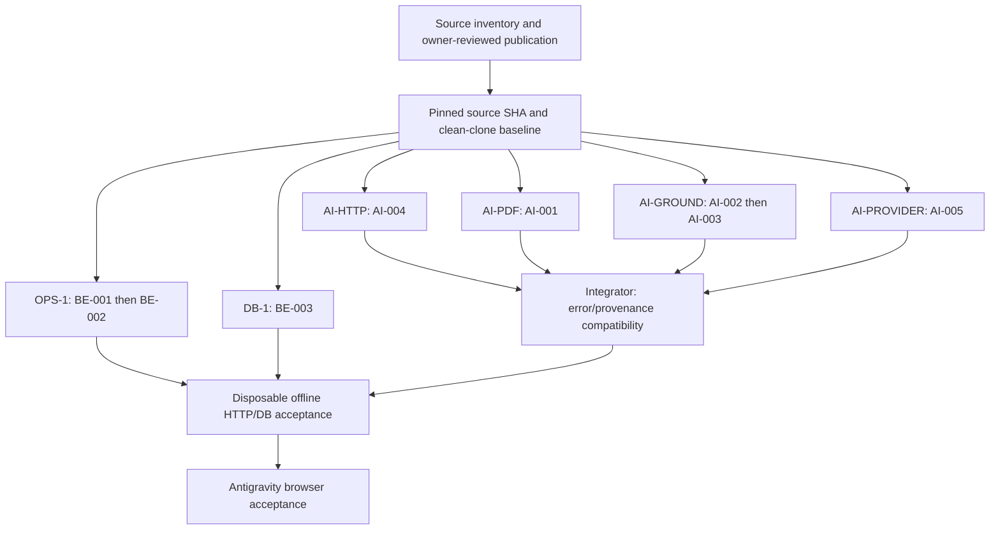

# AIC agent fix handoff — start here

Date: 2026-10-17, Asia/Saigon. Scope: Backend + AI audit, **no source fixes**. [Backend findings](AIC_BACKEND_AUDIT.md) · [AI findings](AIC_AI_SERVICE_AUDIT.md) · [publication checklist](AIC_GITHUB_PUBLISH_CHECKLIST.md).

## Readiness and source identity

**Source availability: READY on `duc`. Runtime/clean-clone acceptance: NOT VERIFIED.** After the initial docs-only publication, the owner explicitly requested all latest code and folders. The reviewed source snapshot is now pinned to **`b528225c7e39ee2476f5c117ce6113b037352fdd`**, commit `chore: publish latest AIC application source`: 454 changed paths covering Backend, Frontend, AI, all migrations/contracts, synthetic ZIP fixtures, scripts and technical documents. Runtime/secret files remain excluded. The earlier remote-absence statements below describe the audit-time snapshot, not the source publication now available.

Publication hygiene changed only `scripts/dev-all.cjs`: embedded DB-password and internal-key fallbacks were removed; explicit environment configuration is required before any process starts. Four VM cases passed with zero real processes or `.env` reads; API no-emit typecheck also passed. BE-001 remains open for hardcoded live mode/shared role configuration, and BE-002 remains open for absent intake topology. The source snapshot is a handoff of current code, not a claim that the audit backlog is fixed. No DB migration, current-process replacement or cloud call occurred.

`AUDIT_BASE_HEAD = 8b0b7ed9e983ba4a2ea4d43f79d1816eaad7dbf0`, local branch `duc`, no upstream at audit start. Source audited is that HEAD **plus dirty worktree**, not HEAD alone. Snapshot at **2026-10-17 21:52:23 +07:00**:

| Measure | Snapshot |
| --- | --- |
| Non-ignored index/worktree paths | 554 |
| Paths with staged changes | 314 |
| Paths with unstaged changes | 93 |
| Untracked paths, expanded | 136 |
| Selected technical text files fingerprinted | 258 |
| Selected apps/api / services/ai / contracts / scripts files | 144 / 67 / 21 / 19 |
| API files at base HEAD | 0 |
| Selected normalized-source digest | `70fb2791385133eae089a7adbcecadf075463a0b2a2f08f1efb46d4227104915` |

Staged/unstaged counts overlap. Generated outputs, ignored secrets/cache, real business files and existing evidence artifacts were not treated as source. The 258-file digest covers selected technical text under apps/api, services/ai (excluding evidence), packages/contracts and scripts plus root manifests/configuration; CRLF is normalized to LF before per-file SHA-256, then sorted `path + NUL + sha256 + LF` is hashed. No bytes are uploaded by that calculation. This is an audit fingerprint, **not a recoverable source archive**.

Observed tool versions: Git 2.55.0.windows.1, PowerShell 7.6.5, Node v24.12.0, pnpm 11.22.0, Python 3.12.10. A final pre-publication recheck of all 258 selected files reproduced the same digest; no audited source drift was detected. This report records component evidence, not the current state of any running service.

Current live remote tips were read without fetch/checkout/index mutation:

| Branch | GitHub tip inspected | API files | Dossier source/contracts |
| --- | --- | ---: | --- |
| main | `f65c22ff49142da9cf930b3f52bafe5f191ac4cd` | 0 | Absent |
| nguyen | `f73d58a3ac218974ea80b8ff26ca2ff25eaa498d` | 0 | Absent |
| tanh | `e41105266673d55e97c6084a75e06227ee82d37d` | 0 | Absent |

Recursive GitHub trees were not truncated. Local remote-tracking refs were stale and were not used as current GitHub evidence. For the selected 258 text paths, main/nguyen each match 63 LF-normalized Git blob IDs, differ on 13 and lack 182; tanh matches 60, differs on 13 and lacks 185. Normalization is disclosed: this comparison does not assert raw checkout EOL equality. `duc` did not exist remotely when publication began; a docs-only `duc` tip still lacks the audited BE/additive implementation.

## Bootstrap for a fresh external agent

```bash
git clone --branch duc https://github.com/tuananhpham-vnu/Fintech.git
cd Fintech
git log -1 --format='%H %cI %s'
git status --short
```

Read this index and both reports. **Stop before implementation if the selected ticket's source/fixtures are absent or differ from its pinned source revision.** Do not request the owner's database, `.env`, DPAPI profile, backup or real documents. Source and the new synthetic ZIPs are included in the pinned publication; externally referenced real/holdout/scan bundles are not required baseline fixtures and were not uploaded.

The owner has now approved source publication. Pin the source commit below, establish a clean-clone baseline and recheck findings before implementing. Audit-time fingerprints remain historical evidence; only the launcher changed during publication hygiene. A fresh-clone install/full acceptance has not yet been executed. The current `duc` tip may also include later documentation updates; do not substitute it for this immutable source revision without checking its diff.

```bash
git checkout --detach b528225c7e39ee2476f5c117ce6113b037352fdd
git switch -c codex/<issue-id>-short-description
# Read the ticket, reproduce first, patch only its owned files, run focused tests.
# Open one reviewable PR per work package after that task's publication approval.
```

In a source-complete clone, prerequisites are Node >=22, pnpm 11.22.0, Python >=3.11, synthetic contract fixtures and the pinned Python dependencies in services/ai/pyproject.toml. Install only into that fresh clone, e.g. `pnpm install --frozen-lockfile`, `python -m venv .venv`, then `.venv/bin/python -m pip install -e './services/ai[dev]'` (Windows uses `.venv/Scripts/python.exe`). **Not executed by this audit**; no lockfile/dependency mutation here. API tests requiring `dist` need a deliberate build inside the disposable clone, never an assumption about the owner's local build.

PG integration additionally needs PostgreSQL binaries and a reviewed disposable-cluster runner. The current launcher is Windows-specific; Linux support is unverified. Never point test variables at the existing main database or rely on loopback alone to prove isolation. Follow the selectedSource/data-directory/password-proof checks in the security harness before any CREATE. No actual PG integration command is authorized on the owner's main DB.

## Architecture and contract authority

```text
Next.js proxy (integration boundary only)
  -> Nest /api/v2 + session/origin/CSRF + case ACL + schema validation
  -> PostgreSQL immutable sources/results, revisions, audit, durable jobs
       -> dossier intake CLI: raw ZIP -> bounded Python ZIP parser -> inspect/promote
       -> extraction CLI: materialize source -> validated AI transport -> fenced publish
  -> FastAPI /internal/v1: key -> schema -> PDF/native text/OCR -> model -> grounding
```

| Authority | Version / role | Consumer / current consistency |
| --- | --- | --- |
| [legacy contracts](../../packages/contracts/VERSION), [schemas](../../packages/contracts/schemas.json), [internal OpenAPI](../../packages/contracts/internal-openapi.json) | 1.0.2 | AI Contracts + BE canonical hash boundary; selected contract/transport tests pass |
| [foundation bundle](../../packages/contracts/aic-foundation/README.md) | 0.4.0-mvp-sandbox, draft-07 definitions/OpenAPI 3.1 | Nest validator and foundation routes; runtime additions exist only locally |
| [demo additive definitions](../../packages/contracts/aic-demo-48h/schemas.json) | Unversioned additive fragment; existing ExtractionSummary | Merged after foundation; must publish hash/revision with source |
| [dossier definitions](../../packages/contracts/aic-dossier/schemas.json) | Unversioned seven-definition additive fragment | Merged third; ExtractionSummary ref remains demo's definition |
| [One-ZIP API contract](../implementation/AIC-ONE-ZIP-DOSSIER-API-CONTRACT.md) | 2026-10-17 local implementation handoff | Five routes/raw 202/retention/counters agree with reviewed code; historical runtime claims not revalidated here |
| [demo API contract](../implementation/AIC-DEMO-48H-API-CONTRACT.md) | 2026-10-17 additive demo path | Legacy caps/routes separate; no FHI approval inferred |
| [owner decisions](../implementation/MVP-OWNER-DECISIONS.md) | Owner methodology/scope context | Read with code; FHI method unconfigured, pilot unauthorized; no scoring permission |

Source/contract links are relative and checked against the local worktree. The source publication now includes the previously absent BE/dossier/contracts paths. Historical parity tables remain evidence of why the initial docs-only handoff was blocked; they do not override the pinned publication update above.

No schema mismatch was found in the tested canonical transport vectors. Error status/code handling in AI-004/AI-005 needs explicit cross-service review; do not change shared field definitions as an incidental OCR patch.

## Ordered backlog

| Order | ID | Priority / confidence | Package | Immediate result required |
| --- | --- | --- | --- | --- |
| 1 | [BE-001](AIC_BACKEND_AUDIT.md#be-001) | P1 / CONFIRMED VM | OPS-1 | Fail-closed explicit modes and separate role configuration |
| 1 | [BE-004](AIC_BACKEND_AUDIT.md#be-004) | P2 / CONFIRMED inventory | PUB-1 | Complete safe source/fixture inventory |
| 2 | [BE-002](AIC_BACKEND_AUDIT.md#be-002) | P1 / CONFIRMED topology | OPS-1 | Include/supervise dossier intake worker |
| 2 | [AI-001](AIC_AI_SERVICE_AUDIT.md#ai-001) | P1 / CONFIRMED synthetic PDF | AI-PDF | Detect corrupt glyph mappings, bounded OCR/review fallback |
| 2 | [AI-003](AIC_AI_SERVICE_AUDIT.md#ai-003) | P1 / CONFIRMED deterministic | AI-GROUND | Language-specific semantic grounding with negative cases |
| 3 | [AI-002](AIC_AI_SERVICE_AUDIT.md#ai-002) | P2 / CONFIRMED deterministic | AI-GROUND | Exact-offset CJK line-wrap matching |
| 3 | [AI-004](AIC_AI_SERVICE_AUDIT.md#ai-004) | P2 / CONFIRMED body reader | AI-HTTP | Delivered-byte input cap before full buffering |
| 3 | [AI-005](AIC_AI_SERVICE_AUDIT.md#ai-005) | P2 / CONFIRMED MockTransport | AI-PROVIDER | Typed malformed upstream JSON handling |
| 3 | [BE-003](AIC_BACKEND_AUDIT.md#be-003) | P2 / CONFIRMED stub readiness | DB-1 | Full read-only migration-ledger validation |

Total **9 open findings: P1 4, P2 5; P0/P3 0. All 9 are confirmed within their stated component scope.** Full operational consequences are distinguished from those probes in each report. Hypotheses/NEEDS_ENVIRONMENT are listed separately, not added to confirmed issue counts.

Highest-risk five work items: explicit safe launcher configuration (BE-001), active intake consumer (BE-002), damaged native-text recovery (AI-001), three-language semantic support (AI-003), and a dependency-complete publication (BE-004, release blocker despite P2 runtime severity).

## Merge order and ownership



Use separate branches/worktrees in an external source-complete clone. Do not create worktrees on top of the owner's unpublished dirty tree or assume they copy dirty files. Shared files have one writer:

- OPS-1: scripts/dev-all.cjs, start-dev.ps1, scripts/tests/unsafe-launcher.test.cjs. Any package.json dev-script changes through integrator.
- PUB-1: scripts/prepare-source-checkpoint.cjs, scripts/create-review-snapshot.cjs and their inventory tests. Explicit fixture hash allowlist only.
- AI-PDF: services/ai/extraction/pdf.py, new test_pdf_text_quality.py, existing test_demo_pdf_regressions.py. No grounding.py/extractor.py edits.
- AI-GROUND: grounding.py, new test_trilingual_grounding.py, role/correctness tests as needed. AI-002 and AI-003 are sequential work within this one package.
- AI-HTTP: runner/app.py, new test_request_limits.py. No provider/grounding changes.
- AI-PROVIDER: providers/gemini.py, tests/test_providers.py. Coordinate any llm.py change with integrator.
- DB-1: database/database.service.ts, new test/database-readiness.cjs. Shared verifier extraction/migrate.ts requires integrator coordination.
- Integrator alone: extractor.py, ocr.py, extraction/__init__.py, llm.py, packages/contracts/**, transport error mapping and cross-service fixtures. OCR engine provisioning/benchmark is its explicit prerequisite, not silently assigned to two packages. Antigravity retains apps/web/** ownership.

Suggested PRs: inventory/bootstrap; launcher safety+intake; PDF detector; CJK+multilingual grounding; input cap; provider decoder; readiness ledger; final integration. Keep root causes separate but merge shared-file changes sequentially. Never change migration SQL/checksums as a fix to readiness validation.

## Copy-paste agent task cards

Each card requires the **actual published source SHA supplied by the integrator**, not just audit base HEAD. If unavailable, report BLOCKED instead of inventing missing source. Read this index, the linked issue, contracts and publication checklist first. Preserve other agents' work; do not use owner's DB/secrets/documents. End every task with `FIXED / TESTED / BLOCKED / REMAINING`, exact commands/counts and changed files.

### OPS-1 card

> Implement BE-001 and BE-002 on branch `codex/be-001-safe-topology` from the integrator's pinned source SHA. Own only launcher/launcher tests listed above. First reproduce environment and missing-intake behavior using VM/fake spawn, never execute the unsafe launcher. Require explicit mode/roles, fail before spawning when prerequisites are absent, then include and supervise intake with owned-process shutdown. Preserve raw-only 202 and separate workers. Do not read DPAPI, `.env` values or start/stop current services. Show red/green pure tests; isolated full-stack validation is a later integration task. No cloud/model calls or credentials in commits.

### PUB-1 card

> Implement BE-004 on `codex/be-004-complete-inventory`. Own checkpoint/snapshot inventory and tests only. Reproduce omitted demo/dossier schema, ZIP helper and synthetic ZIP dependencies with `inspect`. Add exact reviewed paths/hash provenance and completeness tests; retain credential/PDF/private-data blocks. Never run `--stage` or `git add .` on the owner's tree. Provide a concrete per-file publication manifest and clean-clone prerequisite procedure for owner review. Source publication remains a separate explicit Git action.

### AI-PDF card

> Implement AI-001 on `codex/ai-001-text-quality`. Own pdf.py/detector tests only. Generate damaged-map and healthy standard/CJK controls without proprietary fixtures. Add bounded quality detection; missing ToUnicode alone must not force OCR. Preserve PDF/page/pixel/timeout caps and byte identity. Do not modify grounding.py, extractor.py, contracts or OCR credentials. Report actual detector results separately from real OCR accuracy. Escalate adapter integration to the integrator, not another agent's files.

### AI-GROUND card

> Implement AI-002 then AI-003 on `codex/ai-002-trilingual-grounding`. Own grounding.py/multilingual tests only. Reproduce all listed deterministic probes. Preserve reversible source offsets/exact quote, add vi/en/zh-Hans labels/roles/dates/units and negation negatives. Do not fuzzy-match IDs or infer locale/borrower roles. Keep Vietnamese tax_id contract unchanged; foreign IDs/accounting interpretations need owner decision. Coordinate prompt changes through integrator. Run existing role/correctness regressions plus new tests; no live model calls.

### AI-HTTP card

> Implement AI-004 on `codex/ai-004-request-budget`. Own runner/app.py/new limit tests. Reproduce oversized reader allocation with an in-process Request, then enforce streamed delivered-byte limits before full buffering. Cover chunked/misdeclared lengths, unauthorized requests, at-limit valid evaluate payload and sanitized errors. Agree error status/code with integrator first; do not edit shared schemas independently. No listener/DB/cloud required for unit tests.

### AI-PROVIDER card

> Implement AI-005 on `codex/ai-005-provider-json`. Own providers/gemini.py/test_providers.py. Start with malformed outer HTTP-200 JSON red test using MockTransport. Introduce typed bounded parse/envelope handling; keep no fallback, finite retry and body/key redaction. Test malformed inner output and permanent/transient HTTP cases. No API key or external service needed; do not call `list_models`/live smoke.

### DB-1 card

> Implement BE-003 on `codex/be-003-ledger-readiness`. Own readiness service/new unit tests; coordinate any extracted verifier with integrator. First run stub latest-only ledger proof; compare complete ordered local migrations/checksums at readiness, with no repair or migration writes. Keep canonical LF checksums. Test gaps/unknown/history drift and exact valid ledger. Do not connect owner's main DB or alter migration history. Full isolated PostgreSQL validation follows separately.

### Integration card

> Integrate the reviewed package PRs on a new source-complete test branch. Own shared AI adapters/prompts/config/contracts only. Freeze error/provenance compatibility before touching consumers. Provision pinned local OCR engine and vie/eng/chi_sim packs in the disposable environment, benchmark native/scanned/mixed/rotated synthetic documents separately for each language, and preserve review when uncertain. Run fresh DB/HTTP ZIP 30/60, source/hash/version/ACL/fencing tests only with verified disposable resources. No FHI/method/rating/PD change or real-document/cloud processing. Hand host/ports/contracts/evidence to Antigravity for browser E2E; do not declare browser PASS yourself.

## Test recipes

These are auditable source/in-memory recipes, not new source files. Shell syntax below uses Bash heredocs; PowerShell can pass the same body through `@' ... '@ | node` or `@' ... '@ | ./.venv/Scripts/python.exe -B -`. They require the source-complete pinned clone and installed development dependencies. The bodies were executed through PowerShell during audit, except the launcher reproduction below was adapted after removal of its unsafe defaults; the four publication VM cases were executed separately.

### T2 — Execute existing Node boundary tests against current TypeScript without a build

```bash
node <<'NODE'
const fs=require('node:fs'),path=require('node:path'),Module=require('node:module');
const root=process.cwd(),api=path.join(root,'apps/api'),ts=require(path.join(api,'node_modules/typescript'));
const original=Module._resolveFilename;
Module._resolveFilename=function(request,parent,...rest){
  const resolved=original.call(this,request,parent,...rest),prefix=path.join(api,'dist')+path.sep;
  if(typeof resolved==='string'&&resolved.startsWith(prefix)&&resolved.endsWith('.js')){
    const src=path.join(api,'src',path.relative(path.join(api,'dist'),resolved)).replace(/\.js$/,'.ts');
    if(fs.existsSync(src))return src;
  }
  return resolved;
};
require.extensions['.ts']=(mod,file)=>mod._compile(ts.transpileModule(fs.readFileSync(file,'utf8'),{
  compilerOptions:{module:ts.ModuleKind.CommonJS,target:ts.ScriptTarget.ES2022,
  experimentalDecorators:true,emitDecoratorMetadata:true,esModuleInterop:true}
}).outputText,file);
for(const file of ['apps/api/test/ai-adapter-validation.cjs','apps/api/test/ai-adapter-negative.cjs',
  'apps/api/test/ai-response-capture.cjs','apps/api/test/document-ai-transport.cjs',
  'apps/api/test/evidence-projection.cjs','scripts/tests/source-checkpoint.test.cjs',
  'scripts/tests/foundation-release.test.cjs'])require(path.join(root,file));
NODE
```

Limitation: Node's original resolver first requires the dist path to exist before redirection. The owner's dist existed during execution. In a genuinely clean clone, build in that disposable clone first, or adapt the loader to map unresolved dist imports before the resolver. This is an explicit fresh-clone prerequisite, not hidden acceptance. The audit used noEmit and no local build.

### T-AI-1 — Offline Python regression wrapper actually used

```bash
.venv/bin/python -B <<'PY'
import sys,os,socket,ipaddress
sys.dont_write_bytecode=True
safe={k:v for k,v in os.environ.items() if k.upper() in {'PATH','SYSTEMROOT','WINDIR','TEMP','TMP','HOME','USERPROFILE','APPDATA','LOCALAPPDATA','PROGRAMFILES','COMSPEC','PATHEXT'}}
os.environ.clear();os.environ.update(safe)
sys.path.insert(0,'services/ai')
import runner.config
runner.config.load_dotenv=lambda *a,**k: []
original=socket.socket.connect
original_ex=socket.socket.connect_ex
def allowed(address):
    try:return isinstance(address,tuple) and ipaddress.ip_address(address[0]).is_loopback
    except ValueError:return False
def connect(self,address):
    if not allowed(address):raise RuntimeError('AUDIT_EXTERNAL_NETWORK_BLOCKED')
    return original(self,address)
def connect_ex(self,address):
    if not allowed(address):raise RuntimeError('AUDIT_EXTERNAL_NETWORK_BLOCKED')
    return original_ex(self,address)
socket.socket.connect=connect;socket.socket.connect_ex=connect_ex
import pytest
raise SystemExit(pytest.main(['-q','--tb=short','-p','no:cacheprovider',
 'services/ai/tests/test_demo_pdf_regressions.py','services/ai/tests/test_extraction_roles.py',
 'services/ai/tests/test_extraction_robustness.py','services/ai/tests/test_demo_zip_security.py',
 'services/ai/tests/test_dossier_zip_security.py','services/ai/tests/test_providers.py',
 'services/ai/tests/test_app.py','services/ai/tests/test_contracts.py']))
PY
```

This permits asyncio loopback plumbing and MockTransport/in-process ASGI, not arbitrary provider access. Do not append real-PDF/live-subset suites to it without inspecting their resource paths. Snapshot/native parser checks can be adapted in memory; no owner environment is required.

### R-AI-1 / R-AI-2 — Synthetic PDF and language probes

```python
import sys,json,os
from pathlib import Path
sys.dont_write_bytecode=True;sys.path.insert(0,'services/ai')
import pymupdf
from extraction import pdf,grounding as g
font=next((p for p in [Path(os.environ.get('AIC_AUDIT_FONT','/nonexistent')),
 Path('C:/Windows/Fonts/arial.ttf'),Path('/usr/share/fonts/truetype/dejavu/DejaVuSans.ttf')] if p.is_file()),None)
if font is None:raise SystemExit('ENV_BLOCKED: provide a licensed installed font; do not copy real PDFs')
d=pymupdf.open();p=d.new_page();p.insert_font(fontname='demo',fontfile=str(font))
expected='Company name: SYNTHETIC SAMPLE LIMITED. Tax ID: 0109876543.'
p.insert_text((30,60),expected,fontname='demo');f=p.get_fonts()[0]
d.xref_set_key(f[0],'ToUnicode','null');page=pdf.inspect(d.tobytes(),with_pages=True).pages[0]
print({'expected_text_present':expected in page.text,'needs_ocr':page.needs_ocr,'bad_ratio':pdf._garbled_ratio(page.text)})
d.close()
r=g.Registry.from_json(json.loads(Path('packages/contracts/field-registry.json').read_text('utf-8')))
zh='企业名称：示例科技有限公司'
print({'zh_exact':g.find_quote(1,zh,zh,[]) is not None,
 'zh_wrap':g.find_quote(1,zh[:3]+'\n'+zh[3:],zh,[]) is not None})
for key,typ,value,quote in [('payment.date','string','2026-10-17','Payment date: October 17, 2026'),
 ('payment.date','string','2026-10-17','付款日期：2026年10月17日'),
 ('payment.status','string','completed','Payment status: completed'),
 ('financial.unit_multiplier','decimal','10000','单位：万元')]:
    result=g.check_value(key,typ,value,quote,r);print(key,result.value,result.problem)
for key,typ,value,quote in [('parties.borrower.tax_id','string','0109876543','Seller: SYNTHETIC LTD\nTax ID: 0109876543'),
 ('payment.amount','decimal','1250','付款金额：1250')]:
    result=g.check_source(key,typ,value,[g.Span(1,0,len(quote),quote)],[quote],r)
    print(key,result.value,result.problem)
```

The exact corrupted glyph ratio depends on font; Arial yielded 0.22448979591836735 during audit. Other fonts must establish the same false-negative class before claiming that case reproduced. Positive/negative tests should assert behavior, not a platform-specific ratio.

### R-AI-3 — Malformed outer provider JSON

```python
import sys,httpx
sys.dont_write_bytecode=True;sys.path.insert(0,'services/ai')
from providers.gemini import GeminiProvider,GeminiConfig
from extraction.llm import call_json,Deadline,MalformedOutput
p=GeminiProvider(GeminiConfig(api_key='synthetic',model_id='synthetic',max_retries=0),
 client=httpx.Client(transport=httpx.MockTransport(lambda req:httpx.Response(200,content=b'<html>bad upstream</html>'))))
try:call_json(p,'synthetic','synthetic',{},Deadline(2),'audit')
except Exception as exc:print(type(exc).__name__,isinstance(exc,MalformedOutput))
```

Actual `JSONDecodeError False`; after fix require a typed reviewed error, not raw body output.

### R-AI-4 — Body-buffering probe

```python
import sys,json,asyncio
sys.dont_write_bytecode=True;sys.path.insert(0,'services/ai')
from starlette.requests import Request
from runner.app import _read_json
async def run():
    body=b'{"padding":"'+b'x'*(2*1024*1024)+b'"}'
    async def receive():return {'type':'http.request','body':body,'more_body':False}
    req=Request({'type':'http','method':'POST','path':'/internal/v1/inspect','headers':[]},receive)
    parsed=await _read_json(req);print(len(body),len(parsed['padding']))
asyncio.run(run())
```

### R-BE-1 — Safe launcher VM reproduction

```javascript
const fs=require('node:fs'),vm=require('node:vm'),path=require('node:path');
const script=fs.readFileSync('scripts/dev-all.cjs','utf8');
function probe(env){
 const calls=[],proc={env:{...env},platform:'win32',execPath:process.execPath,on(){},exit(code){throw Error('EXIT_'+code)}};
 const fakeFs={existsSync(p){return !String(p).endsWith('.env')},readFileSync(){throw Error('NO_ENV_READ')}};
 const spawn=(exe,args,opts={})=>{calls.push({args,env:opts.env});return{pid:100+calls.length,stdout:{on(){}},stderr:{on(){}},kill(){}}};
 try{vm.runInNewContext(script,{require(n){if(n==='node:child_process')return{spawn};if(n==='node:path')return path;if(n==='node:fs')return fakeFs;throw Error('UNEXPECTED_IMPORT')},
  __dirname:path.resolve('scripts'),process:proc,console:{log(){},error(){}},Buffer},{timeout:1000});}
 catch(exc){if(exc.message==='EXIT_1')return{exited:1,planned_children:calls.length};throw exc;}
 const api=calls.find(c=>c.args.some(x=>/dist[\\/]main\.js$/.test(x))),worker=calls.find(c=>c.args.some(x=>/run-worker\.js$/.test(x)));
 return{planned_children:calls.length,api_mode:api?.env.AIC_DOCUMENT_AI_MODE,ai_mode:calls[0]?.env.AI_MODE,
  shared_role_url:api?.env.DATABASE_URL===worker?.env.DATABASE_URL,
  has_intake:calls.some(c=>c.args.some(x=>/run-dossier-worker/.test(x)))};
}
console.log(probe({}));
console.log(probe({AI_MODE:'mock',AIC_DOCUMENT_AI_MODE:'mock',DATABASE_URL:'postgresql://aic_runtime_api@127.0.0.1:1/synthetic',INTERNAL_API_KEY:'synthetic-key'}));
```

Do not print constructed URLs/keys or run the original script directly. The published source includes the file with its unsafe defaults removed. The first case now exits before spawning; the second still exposes the remaining live/mock mismatch and missing intake child. No owner secret is needed to reproduce those issues.

### R-BE-2 — Readiness stub without a DB

```javascript
const fs=require('node:fs'),path=require('node:path'),crypto=require('node:crypto');
const ts=require('./apps/api/node_modules/typescript');
require.extensions['.ts']=(m,f)=>m._compile(ts.transpileModule(fs.readFileSync(f,'utf8'),{compilerOptions:{module:ts.ModuleKind.CommonJS,target:ts.ScriptTarget.ES2022,experimentalDecorators:true,emitDecoratorMetadata:true}}).outputText,f);
const {DatabaseService}=require('./apps/api/src/database/database.service.ts');
const svc=Object.create(DatabaseService.prototype),seen=[];
const dir='apps/api/migrations',names=fs.readdirSync(dir).filter(n=>/^\d{4}_[a-z0-9_]+\.sql$/.test(n)).sort(),latest=names.at(-1);
const checksum=crypto.createHash('sha256').update(fs.readFileSync(path.join(dir,latest),'utf8').replace(/\r\n/g,'\n')).digest('hex');
svc.query=async(sql,args)=>{seen.push({sql,args});return{rows:sql==='SELECT 1'?[{'?column?':1}]:[{checksum}]}};
svc.onModuleDestroy=async()=>{};
svc.onModuleInit().then(()=>console.log({ready:true,simulated_ledger_rows:1,files:names.length,ledger_lookup:seen.find(x=>x.sql.includes('schema_migrations')).args}));
```

## Unverified acceptance and owner gates

- **LIVE_PROVIDER_NOT_TESTED / BROWSER_E2E_NOT_VERIFIED / MAIN_DB_NOT_ACCESSED.** Actual local OCR three-language quality, whole-process memory/latency, full current PostgreSQL race/HTTP integration and production readiness remain unverified.
- Historical runtime might have changed since earlier reports. This audit neither examined process credentials nor changed process state; do not assume current ports/modes/roles from old logs.
- Existing DB data, real PDF provenance, backups/DPAPI and actual grants are not transferable fixtures. No requirement here permits using them for fixes.
- Owner gates still apply to foreign identifier/accounting semantics, live-provider/real-document transfer, DB migration/grant/data changes, FHI methodology/scoring and process replacement/deployment. Source/fixture publication was explicitly authorized by the later request to push all latest code to `duc` and is recorded by the pinned source commit above.
- After merge: rerun per-language OCR benchmark, complete disposable API/AI/DB acceptance and Antigravity browser tests. Passing mock/component tests is necessary evidence, not a real-dossier readiness certificate.
