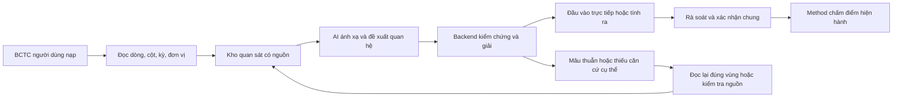

# Kế hoạch hoàn thiện suy luận số liệu BCTC cho AIC

Ngày lập: 19/10/2026. Đã triển khai luồng suy luận V1 vào runtime local và bổ sung migration 0023. Kết quả, cấu hình, giới hạn và các điều kiện nghiệm thu còn mở được ghi tại [bàn giao triển khai](AIC-FINANCIAL-REASONING-IMPLEMENTATION-2026-10-19.md). Kế hoạch dưới đây giữ làm tiêu chí đối chiếu; không đồng nghĩa toàn bộ điều kiện release đã hoàn tất.

Mục tiêu là đọc hoặc suy ra mọi đầu vào mà BCTC có đủ căn cứ xác định, dù tên dòng, bố cục, số trang và các biến trình bày khác nhau. HK VINA 2024 là một ca kiểm thử thực tế, không phải template bắt buộc. Nguồn tính là BCTC và các phần thuyết minh thuộc bộ BCTC người dùng đã nạp. Không bổ sung số liệu từ Internet, benchmark ngành hay ước tính của mô hình vào fact dùng chấm điểm.

Các thiết kế, hạn mức và lịch trình dưới đây là đề xuất kỹ thuật/BA; không được hiểu là quy tắc kế toán hoặc method mới đã được duyệt. Giữ nguyên công thức, ngưỡng, trọng số, phạm vi áp dụng và điều kiện phát điểm của method hiện hành.

**1. Hiện trạng đã đối chiếu**

| Thành phần | Đã có | Khoảng trống |
|---|---|---|
| Đọc nguồn | PDF text/OCR, chuẩn bị Excel/ảnh/PDF từ intake, nhận diện kỳ | Chưa có bảng quan sát kế toán bao quát các dòng và cột; discovery OCR scan bị giới hạn 8 trang, lựa chọn extract tối đa 16 trang/lần |
| AI đề xuất | `financial_import/calculations.py` đọc cả nội dung các trang được chọn, có thể chọn các dòng ngoài 14 key | Một lượt đề xuất; mọi input phải là số in sẵn; cấm derived input; không có quan hệ/bộ nhớ suy luận dùng chung |
| Backend | Postfix + - * /, số học rational chính xác, biểu thức nhiều toán tử, kiểm scope/unit/source | Đánh giá từng đề xuất độc lập; không giải hệ, không tham chiếu kết quả trước, không đối chiếu nhiều đường tính |
| Nguồn | Receipt bất biến, source hash/page/quote, xác thực lại khi áp dụng | Một receipt/source cho một đề xuất, chưa có đầy đủ chuỗi phụ thuộc của nhiều bước |
| UI | Đề xuất, nguồn, áp dụng/gỡ, xác nhận chung | Không có cây tính trung gian, lý do thiếu biến cụ thể hoặc phân biệt lỗi AI với thật sự thiếu dữ liệu |
| Test | Lượt rà soát trước: 9 test AI và 15 test BE đạt | Chưa có bộ oracle độc lập cho suy luận quan hệ/nhiều bước/khác bố cục |

Nguồn code: `services/ai/financial_import/{service.py,contract.py,calculations.py,semantics.py,intake.py}`, `apps/api/src/financial/{financial-calculations.ts,decimal.ts,financial-intake.service.ts,financial-registry.service.ts}`, `packages/contracts/aic-financial-import/calculation-model.schema.json`, UI `calculation-proposals.tsx`.

Đã tái hiện một lỗi nhận diện cần sửa ở P0: nhãn `Unrestricted cash equivalents` bị `semantic_issue` trả `CASH_COMPONENT_NOT_SEPARATE_OR_UNRESTRICTED`, do tìm chuỗi `restricted` nằm trong `unrestricted`. Không gỡ toàn bộ kiểm tra tiền bị hạn chế; thay bằng phân tích nghĩa, phủ định và bằng chứng theo dòng/ngữ cảnh.

**2. Hợp đồng nghiệp vụ cho 14 đầu vào**

Tạo từ điển có phiên bản cho mỗi key: định nghĩa theo method, loại số dư/dòng phát sinh, phạm vi ngắn/dài hạn, gross/net, thành phần bao phủ, điều kiện loại trừ, quy tắc dấu, nguồn trực tiếp, các họ quan hệ hợp lệ, bằng chứng bắt buộc và metric phụ thuộc. Không biến regex nhãn thành toàn bộ định nghĩa kế toán.

| Đầu vào hiện hành | Đường lấy/suy luận dự kiến | Điều kiện kiểm tra |
|---|---|---|
| current_assets | Tổng tài sản ngắn hạn; hoặc tổng các nhóm cấu thành đã chứng minh đầy đủ | Không cộng cả tổng cha lẫn dòng con; không cộng tài sản dài hạn |
| current_liabilities | Nợ ngắn hạn; hoặc tổng nợ trừ nợ dài hạn | Cùng ngày báo cáo, phạm vi và đơn vị; phân loại ngắn/dài hạn rõ |
| cash | Dòng tiền riêng; hoặc tiền và tương đương tiền trừ phần tương đương tiền | Giữ điều kiện tiền đủ tiêu chuẩn của method; không dùng cả tổng hai lần |
| unrestricted_short_term_equivalents | Dòng tương đương tiền đủ tiêu chuẩn; hoặc tổng tiền và tương đương tiền trừ tiền, sau kiểm tra hạn chế sử dụng | Tổng in rõ bằng 0 có thể chứng minh phần đủ tiêu chuẩn bằng 0 nếu miền thành phần không âm đã được xác nhận; không đòi thêm số không có ý nghĩa trong trường hợp này |
| trade_receivables | Phải thu khách hàng theo đúng gross/net và kỳ hạn method yêu cầu; nếu net thì gross trừ dự phòng được phân bổ đúng khoản | Không dùng tổng mọi khoản phải thu; không trừ toàn bộ dự phòng chung nếu chưa chứng minh phân bổ |
| total_equity | Tổng vốn chủ sở hữu; hoặc tổng tài sản trừ tổng nợ | Phạm vi hợp nhất/riêng lẻ khớp; xử lý lợi ích không kiểm soát đúng định nghĩa |
| total_assets | Tổng tài sản; hoặc các nhóm tài sản; hoặc nợ cộng vốn | Tất cả quan hệ phải đúng scope; số tổng và các nhóm có thể được làm tròn |
| total_liabilities | Tổng nợ; hoặc nợ ngắn hạn cộng dài hạn; hoặc tài sản trừ vốn | Không đồng nhất với nợ vay chịu lãi |
| interest_bearing_debt | Tổng nợ vay đủ tiêu chuẩn; hoặc tổng danh mục nợ đủ điều kiện đầy đủ | Bao gồm/loại trừ thuê, trái phiếu, phần đến hạn theo method; tránh cộng phần đến hạn hai lần |
| operating_profit | Dòng lợi nhuận hoạt động đúng định nghĩa; hoặc đẳng thức từ doanh thu/chi phí đủ thành phần | Chốt ý nghĩa `operating_profit` và tên EBIT đang dùng trong method; không tự thay bằng LNST/LNTT/EBITDA |
| depreciation_amortization | Tổng D&A của kỳ đúng phạm vi method; hoặc tổng các phần đủ điều kiện; hoặc bảng biến động đầy đủ | Phân biệt chi phí kỳ với hao mòn lũy kế; không coi mọi phân bổ trả trước là amortization; không cộng lại phần chưa được trừ trong lợi nhuận đầu vào |
| interest_expense | Chi phí lãi vay phát sinh của kỳ; hoặc phần lãi tách được từ chi phí tài chính | Không thay bằng tổng chi phí tài chính hoặc tiền lãi đã trả; vốn hóa phải xử lý theo định nghĩa method |
| net_revenue | Doanh thu thuần; hoặc doanh thu trừ các khoản giảm trừ đầy đủ | Đúng cơ sở doanh thu method; không lấy chỉ một mảng khi tổng yêu cầu rộng hơn |
| cash_from_operations | Lưu chuyển tiền thuần HĐKD; hoặc tổng các luồng HĐKD; hoặc phép đối chiếu gián tiếp đủ điều chỉnh | Không thay bằng lợi nhuận hay tiền bán hàng thu vào; cùng khoảng thời gian, cùng chính sách phân loại |

Mã số biểu mẫu được dùng như tín hiệu hỗ trợ cùng tiêu đề/ngữ cảnh/chế độ kế toán; không bắt buộc phải có mã, không cố định tọa độ. Bộ từ điển tách phiên bản theo chế độ kế toán và cơ sở báo cáo. TT99 có hiệu lực từ 01/01/2026; không áp bộ mã của báo cáo mới vào báo cáo 2024 chỉ vì đang chạy hệ thống trong năm 2026.

Ba điểm P0 phải đối chiếu với định nghĩa method trước khi sửa mapping: phải thu gross/net và kỳ hạn; ý nghĩa lợi nhuận hoạt động/EBIT; phạm vi D&A được cộng lại. Chỗ nào tài liệu method chưa rõ phải ghi nhận rõ sự thiếu nhất quán, không tự tạo số hoặc thay công thức để đạt 14/14.

**3. Quy tắc chứng cứ và trạng thái**

Mỗi số có hai trục riêng: nguồn gốc `direct/derived` và tình trạng suy luận `resolved/review_required/conflict/unresolved`. Xác minh vẫn dùng `unverified/verified/stale` của hệ thống. Tính chính xác không tự đồng nghĩa với đã được con người xác nhận.

Các quy tắc bắt buộc:

- Số 0 in rõ là số liệu; blank, dash, không có dòng và OCR chưa đọc được là các tình trạng khác nhau. Chỉ diễn giải dash thành 0 nếu có quy ước trình bày rõ cho đúng bảng/cột đó, lưu quy ước và nguồn.
- Số 0 suy ra phải có phép chứng minh, ví dụ tổng A=0, A=B+C, B/C không âm và phân rã đầy đủ. Không áp quy tắc này cho subtotal có khoản điều chỉnh âm.
- Mọi nguồn phải cùng doanh nghiệp, scope kỳ, cơ sở riêng lẻ/hợp nhất, phiên bản/restate và chế độ được phép so sánh. Số dư đầu kỳ là một mốc thời gian khác số dư cuối kỳ; phép biến động có thể dùng cả hai nhưng phải khai báo vai trò, không tự đổi nhãn năm.
- Đơn vị tiền được chuẩn hóa bằng hệ số chính xác và có trace; ngoại tệ khác nhau không được quy đổi nếu method không có chính sách. Dấu ngoặc âm, dấu phân cách số theo từng cột và các số được làm tròn phải được lưu.
- Cộng/trừ chỉ giữa đại lượng cùng nghĩa, đơn vị và độ bao phủ. Phép nhân/chia cần đúng đơn vị, mẫu khác 0 và không tự thêm giả định.
- Không dùng confidence của LLM để thay bằng chứng. Các đề xuất quan hệ chưa được xác nhận về ngữ nghĩa vẫn ở trạng thái cần rà soát dù ra một đáp án duy nhất về toán học.
- BCTC là dữ liệu không đáng tin về mặt chỉ dẫn: không thực thi công thức/code do tài liệu hoặc mô hình cung cấp; chỉ chấp nhận AST có kiểu và toán tử được liệt kê.

**4. Kiến trúc đề xuất**

Luồng chung: tài liệu gốc -> quan sát theo ô/dòng -> khái niệm kế toán -> quan hệ -> bộ giải chính xác -> 14 đầu vào -> xác nhận chung -> scorer hiện hành.



AI phụ trách nhận diện, diễn giải nhãn, đề xuất quan hệ và tìm nguồn còn thiếu. Backend phụ trách chứng cứ, quan hệ được phép, giải toán, xung đột, phiên bản và điều kiện đưa vào method. Không thêm một model/SDK/provider mới để làm cơ chế này; tiếp tục dùng adapter DeepSeek hiện tại.

**5. Kho quan sát và mô hình dữ liệu**

Không chỉ lưu 14 đầu vào. Lưu các dòng/phần thuyết minh có số liên quan, các tổng/nhóm con, quan hệ biểu mẫu, tiêu đề, đơn vị và quy ước dấu của bảng. Quét/index toàn bộ tài liệu thuộc giới hạn hỗ trợ; trích theo batch và ưu tiên các vùng cần cho 14 mục tiêu. Không gửi tất cả trang của ZIP trong một prompt.

Các thực thể đề xuất:

| Thực thể | Nội dung tối thiểu |
|---|---|
| reasoning_run | tenant/case, source manifest và hash, scope, snapshot revision, trạng thái, coverage, model/prompt/mapping/solver version, budget/diagnostics |
| observation | nguồn gốc, trang/bảng/cột/ô hoặc bbox nếu có, raw label/code/token, quote, raw unit/currency/locale, normalized exact value, instant/duration, scope, number precision, blank/dash/zero |
| concept_binding | concept chuẩn hoặc thành phần tự do có type, gross/net, maturity, group membership, coverage, scope role, mapping evidence, trạng thái cần rà soát |
| relation | AST/phương trình, các node ID, loại sum/difference/roll-forward/equality, template/rule version, nguồn hoặc rationale, điều kiện áp dụng, coverage/non-overlap, verification state |
| derivation | node đích, exact rational value, relation/input revisions, tập leaf observation IDs, intermediate nodes, kết quả đối chiếu, root proof hash |
| target_resolution | một trong 14 key, direct/derived, giá trị/null, proof, diagnostic code, ảnh hưởng metric, điều kiện rà soát/xác nhận |

Định danh node do server quản lý, theo tenant/case/run/scope; không tin ID mô hình tự đặt là dữ liệu đã tồn tại. Không hợp nhất hai số chỉ vì cùng nhãn hoặc cùng giá trị. Giữ các quan sát đối chứng của cùng concept thay vì ghi đè.

Persistence đề xuất: bảng `financial_reasoning_runs`, `financial_observations`, `financial_relations`, `financial_derivations`, cùng resolution gắn với snapshot. Tên/thiết kế chi tiết chốt khi freeze contract. Giữ các fact/source hiện có để scorer không phải hiểu graph. Fact mới tham chiếu root proof của run bất biến. Migration chỉ thêm cấu trúc; không sửa checksum migration 0001-0022, không disable trigger cũ, không tự chạy lại hồ sơ cũ.

**6. Thuật toán suy luận và giới hạn**

V1 triển khai hai loại bộ giải trên cùng mô hình, không viết riêng cho từng tổ hợp biến thiếu.

Loại 1: quan hệ đã có đủ toán hạng. Duyệt graph và tính biểu thức chính xác; kết quả là một node mới có proof gồm toàn bộ lá nguồn. Quan hệ có thể dùng node đã suy ra, nhưng không được tham chiếu kết quả chưa chứng minh hoặc phụ thuộc vào chính nó.

Loại 2: các quan hệ tuyến tính cần giải đồng thời. Chuẩn hóa về hệ số rational và giải theo nhóm cùng scope. Kiểm tra mục tiêu có giá trị duy nhất, kể cả khi các biến phụ khác chưa xác định duy nhất. Hệ vô nghiệm là conflict; hệ có nhiều nghiệm không được lấy một nghiệm tùy ý. Biến tự do không tự bằng 0. Không chỉ kiểm tra số lượng phương trình so với số ẩn; phải kiểm tra hạng và tính độc lập.

Ví dụ synthetic:

```
Tổng nợ = Nợ ngắn hạn + Nợ dài hạn
Nợ ngắn hạn = Phải trả + Vay ngắn hạn
Tổng nợ = 100; Nợ dài hạn = 20; Phải trả = 30
=> Nợ ngắn hạn = 80
=> Vay ngắn hạn = 50
```

Mỗi quan hệ trong ví dụ thực tế phải có đủ phần phân rã và điều kiện kế toán, không chỉ đúng ký hiệu.

Graph dữ liệu dùng để tính phải không có vòng phụ thuộc. Nhóm phương trình liên hệ vòng có thể giải như một hệ độc lập; chỉ công bố các kết quả chứng minh được từ quan sát bên ngoài, không tạo chứng cứ vòng X từ Y rồi Y từ X.

Biểu thức có nhân/chia chỉ chạy khi toán hạng đã biết và mẫu khác 0. Không tự giải hệ phi tuyến hay chọn dấu nghiệm ở V1. Các hệ số 1/-1 và hệ số chuyển đơn vị là hằng số cấu trúc của quan hệ đã kiểm tra; không là số tiền mô hình tự thêm vào.

Nếu cùng mục tiêu có hai đường tính: giữ cả hai, so sánh exact value và tập nguồn. Bằng nhau thì bổ sung chứng cứ đối chiếu, không tăng confidence như hai chứng cứ độc lập khi chúng dùng cùng lá. Khác nhau thì conflict, tìm trang/cột/scope/đơn vị có vấn đề. Không chọn đường ra điểm cao hơn hoặc trung bình hai kết quả.

Nhận diện subtotal và membership để tránh cộng cha và con. Không dùng lệnh cấm mọi input lặp lại như hiện tại để thay thế kiểm tra double-count; quan hệ đại số có thể có lặp hợp lệ. Phải kiểm tra hệ số sau biến đổi và phạm vi kinh tế được cộng, trừ.

Giữ `Decimal` rational hiện có cho cả trung gian; không làm tròn trước khi đưa vào bước kế tiếp. Nếu kết quả cuối không biểu diễn đúng theo contract decimal hiện hành, giữ proof nhưng chặn publication với `PRECISION_POLICY_REQUIRED`; chỉ mở chính sách làm tròn khi được xác định riêng. Không đổi scorer hoặc đơn phương áp sai số 0,5%.

Hạn mức khởi đầu đề xuất để benchmark: 500 observations/batch, 100 relations/nhóm scope, 20 ẩn/hệ liên thông, tối đa 8 tầng tính, tối đa 3 lượt tìm/đề xuất bổ sung mỗi scope sau trích xuất. Kiểm soát số chữ số của rational, thời gian solver và kích thước proof. Khi chạm giới hạn trả mã cụ thể, không báo đã đọc đủ rồi kết luận thiếu biến.

**7. AI và kiểm tra quan hệ kế toán**

Tách AI thành các output có schema riêng: quan sát; ánh xạ concept; đề xuất relation; yêu cầu tìm nguồn. Mô hình trả node tham chiếu và quan hệ, không trả giá trị tính cuối để backend tin trực tiếp.

Ưu tiên quan hệ theo thứ tự: công thức/đối chiếu in trên BCTC; họ quan hệ kế toán có phiên bản đúng chế độ và điều kiện; đề xuất ngữ nghĩa mới cần rà soát. Thư viện là các họ quan hệ với biến tham số, không phải các if/else cho từng trường thiếu, tên file hoặc số trang.

Nếu một mục tiêu chưa giải được, yêu cầu AI nêu biến/điều kiện nào còn thiếu và vị trí dự kiến trong tài liệu đã nạp. Tìm theo index, lấy thêm batch đúng vùng, kiểm số/nguồn rồi giải lại. Phân biệt `OCR_PAGE_FAILED`, `NOT_SEARCHED`, `MODEL_UNAVAILABLE`, `MODEL_OUTPUT_INVALID`, `BUDGET_EXHAUSTED`, `INSUFFICIENT_EVIDENCE`, `UNDERDETERMINED`, `CONFLICT`, `METHOD_SEMANTIC_UNRESOLVED`. Không nuốt lỗi optional thành một mảng rỗng không có nguyên nhân.

Nhãn nhiều ngôn ngữ và mã số chỉ là tín hiệu. Phải đọc các qualifier: tổng/thành phần, trước/sau dự phòng, ngắn/dài hạn, riêng lẻ/hợp nhất, tiền phát sinh/tiền đã chi, restricted/unrestricted. Kiểm tra dấu phủ định theo ngữ cảnh; không whitelist một từ rồi áp cho mọi báo cáo.

**8. Tích hợp backend, worker và vòng đời dữ liệu**

Thêm version contract suy luận mới, giữ consumer V1 đọc được receipt cũ và đường áp dụng công thức hiện có. `extend-financial-calculations.cjs` và các script generate là nguồn cần cập nhật cùng schema/validator/consumer; không chỉ sửa file JSON sinh ra.

Các thao tác logical dự kiến: bắt đầu/tiếp tục run; xem coverage và resolutions; xem proof; resolve conflict bằng chọn nguồn có lý do; áp dụng các target đã rà soát. Route và version chính thức freeze cùng contract; chưa coi các tên dự kiến là API đã có.

Sử dụng worker intake hiện có làm bộ điều phối các giai đoạn, giữ lease/fence/CAS và idempotency. Không giữ DB transaction mở trong khi gọi AI. Ghi batch bất biến và checkpoint; tiếp tục ở batch lỗi, không OCR lại toàn ZIP. Reconcile toàn bộ snapshot trước khi công bố target.

Không nâng giới hạn response 1MB một cách vô điều kiện. Phân trang observations/proof và chunk các output nội bộ. AI lỗi ở giai đoạn suy luận không làm mất các fact trực tiếp đã được kiểm chứng.

Cache theo verified source bytes/page/OCR version; quan sát theo source/parser version; derivation theo leaf revisions/relation version/solver version. Cache riêng tenant/case với kiểm tra quyền mỗi lần đọc, không tạo endpoint hash công khai. Không cache lỗi như một kết quả thiếu dữ liệu vĩnh viễn.

Khi thay số, đổi đơn vị/kỳ/basis, thay bản BCTC hoặc relation: đánh dấu stale mọi node dẫn xuất phụ thuộc, các bridges, xác nhận chung và assessment liên quan. Chỉ tính lại nhánh phụ thuộc. Server truy ngược proof để chống sửa giá trị/tráo scope; không nhận computed_value hay verification từ client làm nguồn tin.

**9. Giao diện và điều kiện chấm điểm**

Giữ bảng 14 đầu vào và một lần xác nhận chung. Mỗi dòng cho biết đọc trực tiếp/tính ra, trạng thái, số bước, nguồn và metric liên quan. Mở dòng dẫn xuất để xem cây: kết quả -> công thức -> trung gian -> các dòng BCTC. Phải đi đến được mọi lá nguồn, không chỉ trang đầu tiên.

Đề xuất hợp lệ có thể áp dụng một lần theo nhóm sau rà soát; không bắt người dùng xác minh từng ô. Nếu còn qualifier cần xác nhận, trình bày rõ ngay trong lần rà soát chung. Áp dụng số khác với xác minh; thay đổi một nguồn làm xác nhận cũ hết hiệu lực.

Ví dụ lời giải thích: “Chưa xác định khoản dự phòng dành riêng cho phải thu khách hàng” hoặc “Trang chứa bảng biến động chưa đọc được”, thay vì tất cả cùng thành N/A. UI không đưa kỹ thuật AST/solver/JSON vào luồng người dùng.

Scorer tiếp tục dùng 14 fact và bridge hiện có. Graph giải đủ số nhưng bridge kế toán chưa hợp lệ vẫn chưa đủ điều kiện phát điểm. Không tự tính lại trọng số, lấy số năm khác hoặc phát điểm sơ bộ bằng method cũ khi chưa đủ điều kiện. Không mở thêm ngành chỉ vì đã đọc được BCTC.

**10. Công việc, phụ thuộc và tiêu chí hoàn thành**

| ID / ưu tiên | Công việc và module chính | Phụ thuộc | Tiêu chí hoàn thành |
|---|---|---|---|
| BA-01 / P0 | Từ điển 14 key, qualifier, các họ quan hệ và bảng đối chiếu method | Không | Mỗi key có đường lấy trực tiếp/suy ra, điều kiện, counterexample, scope; nêu rõ 3 điểm phải thu/operating profit/D&A |
| QA-01 / P0 | Oracle bằng tay từ BCTC thực tế và các case suy luận nhỏ | BA-01 | Số kỳ/trang/cột/nguồn được đối chiếu; mỗi target expected value hoặc lý do chưa đủ, không sửa expected để theo AI |
| AI-01 / P0 | Sửa nhận số 0, qualifier, lỗi unrestricted; diagnostics optional | BA-01 | Số 0 không bị coi là missing; restricted/unrestricted và gross/net có test đối lập; lỗi AI khác thiếu bằng chứng |
| CT-01 / P0 | Contract observation/relation/proof/run/resolution, version/backward compatibility | BA-01 | Schema/validators/vectors và script generate đồng bộ; producer/consumer dùng được receipt cũ |
| DB-01 / P0 | Bảng kho quan sát/run/quan hệ/proof, khóa tenant/scope, migration additive | CT-01 | Nâng DB clone thành công; checksum cũ giữ nguyên; app cũ vẫn đọc fact cũ, không tự mutate hồ sơ hiện tại |
| AI-02 / P0 | Trích các dòng liên quan ngoài 14 key theo batch, bảng/cột/scope | CT-01, DB-01 | Có thể dùng một thành phần chưa là đầu vào scorer; kiểm tra leaf source; không nhầm comparative và opening balance |
| BE-01 / P0 | AST validator, solver graph, hệ tuyến tính bounded, conflict/proof | CT-01, BA-01 | Giải nhiều bước, xác định duy nhất theo target, phát hiện vô nghiệm/đa nghiệm; arithmetic exact và đầy đủ chuỗi nguồn |
| AI-03 / P0 | Planner quan hệ và vòng tìm bằng chứng có giới hạn | AI-02, BE-01 | Quan hệ in sẵn hoặc họ hợp lệ được xử lý; thiếu nguồn thì đọc đúng vùng, không thêm giá trị không có nguồn |
| INT-01 / P0 | Worker/checkpoint/cache, CAS/fence, projection về fact/bridge | DB-01, BE-01, AI-03 | Restart/duplicate job không tạo fact trùng; nguồn đổi làm stale; API chỉ áp dụng từ immutable proof |
| FE-01 / P1 | Bảng trạng thái, cây nguồn, conflict, nhóm áp dụng và xác nhận chung | CT-01, INT-01 | Người dùng đi được từ mọi số tính ra tới các lá nguồn; thao tác một lần theo nhóm, không cần biết công thức postfix |
| QA-02 / P0 trước release | Regression, oracle độc lập, nhiều bố cục, UAT Chrome | Các phần trên | Đạt bộ case và điều kiện release ở mục 11; giữ nguyên kết quả scorer cho cùng đầu vào |
| OPS-01 / P1 | Hạn mức, thống kê thời gian/calls/cache/coverage, rollout flag | INT-01, QA-02 | Nhìn được chậm ở OCR/extraction/solver; rollback về V1 không mất fact/receipt đã lưu |

P2 sau MVP: hệ phi tuyến có miền nghiệm phức tạp; tự học quan hệ từ reviewer; tìm dữ liệu bên ngoài; chuẩn hóa các ngành ngoài method. Không đưa các hạng mục này vào đường găng để giải vấn đề hiện tại.

**11. Kiểm thử và nghiệm thu**

Oracle phải độc lập với solver: phép tính tay có người rà soát và phép kiểm chéo Python Fraction/Decimal không copy thuật toán BE. Tách bộ phát triển khỏi bộ báo cáo chưa dùng để chỉnh prompt. Mục tiêu ban đầu đề xuất tối thiểu 12 báo cáo thực tế có quyền dùng, nhiều bố cục/đơn vị/scan/native và các kỳ/chế độ nằm trong phạm vi; không tuyên bố đang có đủ 12 file.

| Nhóm | Tình huống | Expected |
|---|---|---|
| Đọc trực tiếp | Dòng in rõ số 0; ô rỗng; dash; OCR thất bại | Bốn trạng thái tách biệt; không fill 0 tùy tiện |
| Ánh xạ | Đổi nhãn/mã/vị trí/trang nhưng giữ nghĩa; restricted/unrestricted | Kết quả giữ đúng; không lệ thuộc HK VINA |
| Suy ngược | Thiếu C trong A=B+C, đủ A/B | C chính xác, có proof quan hệ và lá nguồn |
| Nhiều bước | X=A-B rồi Y=X-D | Y chính xác; cây có X và toàn bộ lá |
| Biến ngoài 14 | Thành phần tự do dùng tính một target | Được nhận vào kho biến, không thêm key mới cho scorer |
| Hệ tuyến tính | Các phương trình độc lập đủ xác định mục tiêu | Giải chính xác; hệ số/scope/nguồn kiểm tra được |
| Hệ thiếu dữ kiện | X+Y=10 | Không tự gán X/Y; trả UNDERDETERMINED |
| Target duy nhất | Một nhóm có biến tự do nhưng target khác xác định được | Chỉ xuất target đủ căn cứ; không chặn toàn run |
| Quan hệ vòng | X từ Y, Y từ X, không có neo nguồn | Không tạo số hoặc proof vòng |
| Đối chiếu | Hai đường cùng kết quả / khác kết quả | Một resolution có hai proof / conflict không bị ghi đè |
| Double-count | Tổng cha cộng dòng con, phần đến hạn xuất hiện hai chỗ | Chặn cộng trùng theo membership, không chỉ theo số bằng nhau |
| Phải thu | Gross + dự phòng có/không chứng minh phân bổ | Chỉ suy ra net khi đủ phạm vi; không lấy toàn bộ dự phòng chung |
| D&A | Hao mòn đầu/cuối kỳ có thanh lý/điều chỉnh; hai số dư bằng 0 | Không suy chi phí kỳ bằng chênh lệch đơn giản hoặc bằng 0 nếu thiếu biến động |
| Dấu/đơn vị | Âm trong ngoặc, nghìn/triệu, số làm tròn | Chuẩn hóa chính xác; khi không đủ precision cho fact thì báo rõ |
| Scope | Khác năm, đầu kỳ/cuối kỳ, parent/consolidated, restated | Phân tách đúng; chỉ dùng quan hệ biến động nếu vai trò thời gian được phép |
| Độ bền | API timeout, output sai, batch partial, retry/restart | Fact trực tiếp còn nguyên; có stage error; không đọc lại toàn bộ nếu cache còn hợp lệ |
| Quyền | Tráo tenant/source/run/proof/value/scope | Server từ chối; không lộ dữ liệu qua cache hoặc ID |
| Stale | Sửa một leaf/relation/source sau xác nhận | Tất cả target/bridge/assessment phụ thuộc hết hiệu lực; nhánh độc lập được bảo toàn |
| Scoring | Cùng bộ 14 đầu vào/bridge trước và sau nâng cấp | Cùng điểm/trace theo method; không đổi ngưỡng/trọng số |
| UX | Upload -> đọc -> suy luận -> rà soát -> xác nhận -> đánh giá | Thử trực tiếp Chrome, ghi bước/nguồn/kết quả; không coi HTTP test là UAT web |

HK VINA 2024 phải có một bảng expected riêng: phân biệt số thực sự đọc được, số suy được, và vấn đề ngữ nghĩa chưa chứng minh. Không đặt expected 14/14 bằng cách tự gán D&A=0 hoặc net receivables=gross. Nếu không đủ xác định một target từ bộ trang đang có, hệ thống phải chỉ rõ biến/điều kiện còn thiếu và bằng chứng đã tìm, thay vì trả N/A chung chung. Đây là tiêu chí chứng minh giải đúng, không phải thay đổi phạm vi nguồn của người dùng.

Điều kiện release: 100% expected target đủ căn cứ trong bộ nghiệm thu được giải đúng; mọi giá trị xuất bản có proof truy đến nguồn; không có trường hợp fill số không có căn cứ trong bộ negative; kiểm thử chain/conflict/stale/tenant đạt; bộ method không đổi; coverage và lỗi được hiển thị trung thực. Các con số này là mục tiêu nghiệm thu trên bộ test, không phải tuyên bố độ chính xác cho mọi BCTC ngoài thực tế.

**12. Hiệu năng, lịch thực hiện và bàn giao**

Đo riêng thời gian đọc PDF/OCR, ánh xạ, đề xuất quan hệ, solver, DB, tổng thời gian; model calls/tokens/retry/độ phủ/cache hit. Solver thuần phải hoàn tất trong budget cấu hình; giá trị khởi đầu đề xuất P95 dưới 1 giây cho một nhóm nhỏ sau khi benchmark trên máy thực tế. Không cam kết thời gian OCR/AI trước khi đo. Warm run cùng bytes/version không OCR lại các trang đã có; thất bại một proposal không bắt đọc lại ZIP.

Ước lượng kế hoạch: 10-15 ngày công cho một người làm đầy đủ và kiểm thử, với dữ liệu/gold đủ sẵn. Có thể chồng lấp AI/BE/FE sau khi chốt contract; đây không phải cam kết ngày hoàn thành. Phát hiện cần sửa định nghĩa method hoặc thiếu bộ oracle làm thay đổi ước lượng.

| Mốc | Đầu ra |
|---|---|
| M1, ngày công 1-2 | Từ điển 14 key, bảng gap method, gold ban đầu, quick fixes số 0/qualifier/diagnostics |
| M2, ngày công 3-5 | Contract + persistence additive + kho quan sát và chuẩn hóa scope/đơn vị |
| M3, ngày công 6-9 | Solver graph/hệ tuyến tính, AI relations, proof và conflict; unit/integration oracle |
| M4, ngày công 10-12 | Worker/checkpoint/projection/stale và UI nhóm rà soát/xác nhận |
| M5, ngày công 13-15 | Đa bố cục, hồi quy scorer, benchmark, Chrome UAT, báo cáo nghiệm thu |

Bàn giao gồm: từ điển kế toán; thư viện họ quan hệ có phiên bản; contract và migration; dữ liệu oracle có nguồn; test log; kết quả Chrome UAT; benchmark; hướng dẫn cấu hình và giới hạn; kế hoạch rollback. Rollout bằng cờ mới bên cạnh `AI_FINANCIAL_CALCULATIONS`; giữ đường V1 cho receipt cũ, không xóa code đang hoạt động trước khi V2 đạt nghiệm thu.

**13. Nguồn đối chiếu và giới hạn xác minh**

- Code trong working tree hiện tại là nguồn trạng thái triển khai. Các kết quả test 9 AI/15 BE là bằng chứng của lượt audit ngay trước kế hoạch, không phải test của tính năng graph chưa viết.
- [Thông tư 200/2014/TT-BTC - Công báo Chính phủ](https://congbao.chinhphu.vn/van-ban/thong-tu-so-200-2014-tt-btc-6697/3479.htm): nguồn để đối chiếu phiên bản biểu mẫu và quy tắc tương ứng các kỳ lịch sử. Bộ mapping chi tiết vẫn phải có đối chiếu từng dòng khi thực hiện BA-01; không coi bảng đề xuất trong kế hoạch là bản chép toàn văn đã xác minh.
- [Thông tư 99/2025/TT-BTC - Công báo Chính phủ](https://congbao.chinhphu.vn/van-ban/thong-tu-so-99-2025-tt-btc-46529.htm): trang công bố xác nhận hiệu lực 01/01/2026; cần tách phiên bản chế độ, không dùng một bộ mã cho mọi năm.
- [IFRS Foundation - IAS 7](https://www.ifrs.org/issued-standards/list-of-standards/ias-7-statement-of-cash-flows/): phương pháp trực tiếp/gián tiếp và đối chiếu tiền/tương đương tiền; dùng làm căn cứ phân biệt cách trình bày, không tự áp quy tắc IFRS cho báo cáo VN.
- [IFRS Foundation - IAS 16](https://www.ifrs.org/issued-standards/list-of-standards/ias-16-property-plant-and-equipment/): phân biệt tài sản, khấu hao và giá trị ghi sổ; cần đối chiếu biến động khi suy từ số dư, không đồng nhất với chi phí kỳ.
- Bản Notion methodology gốc đã được tham chiếu bởi tài liệu repo nhưng lần fetch gần nhất trả 404; chưa thể xác nhận lại toàn văn hiện hành từ connector. BA-01 phải đối chiếu bản method có quyền truy cập với code/tài liệu local, không kết luận một điều kiện thuộc/không thuộc method chỉ từ regex hiện tại.

Kế hoạch này không tạo migration, không chạy AI đọc lại BCTC, không đổi `.env`, không thay method, không sửa/xóa dữ liệu và không khởi chạy dịch vụ.
