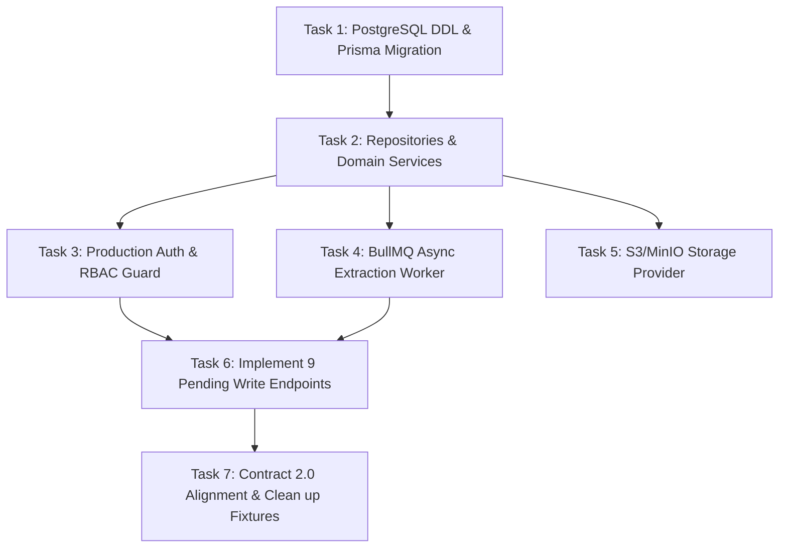

# AIC Rating 2.0 — Codex Backend Handoff Document
**Dự án:** AIC Rating 2.0 — FinTechathon 2026
**Người chuẩn bị:** Senior Full-Stack Engineer (Nhánh: `duc`)
**Đối tượng tiếp quản:** GPT-6.1 Sol (Codex) — Lead Backend Engineer
**Ngày bàn giao:** 16/10/2026
**Tham chiếu kỹ thuật:** Notion Master (`1790c2f0937d8344bc9781bc9b4efd32`), Trang 04 (Kiến trúc & Ranh giới), Trang 06 (Bảo mật & Negative Tests), Trang 08 (Database DDL), Trang 09 (API Design), Trang 10 (DTO Dictionary), Trang 12 (Frontend Integration), Trang 13 (Methodology & FHI).

---

## A. Verified State (Hiện Trạng Kỹ Thuật Đã Kiểm Chứng)

### 1. Môi trường & Working Tree
- **Git Branch:** `duc`
- **Working Tree:** Đang bảo lưu toàn bộ thay đổi, tuyệt đối không tự ý commit hoặc xóa file theo ràng buộc dự án.
- **Cấu trúc Monorepo:**
  - `apps/web`: Next.js 16.4.0 (Turbopack, React 19, TypeScript) — Port `3000`.
  - `apps/api`: NestJS 11 (Express, Multer, Cookie-Parser) — Port `3001` (`/api/v2`).
  - `services/ai`: FastAPI AI Runner (PyMuPDF, Pydantic, Contracts 1.0.2) — Port `8100` (`/internal/v1`).
  - `packages/contracts`: Canonical JSON Schemas 1.0.2, OpenAPI, Internal OpenAPI, Fixtures.
  - `storage/staging`: Thư mục lưu trữ nhị phân PDF dùng chung giữa NestJS và FastAPI.

### 2. Các Module Backend Hiện Có (`apps/api/src/`)
- `config/configuration.ts`: Quản lý biến môi trường tập trung, có validation port, AI URL, storage path và production guards.
- `ai-client/ai-client.service.ts`: Adapter HTTP giao tiếp FastAPI (`/inspect`, `/extract`), hỗ trợ `AbortSignal.timeout(30s)`, bắt lỗi mạng/timeout và ánh xạ mã lỗi 502/503/504.
- `storage/storage.service.ts`: Quản lý staging PDF, tính SHA-256, kiểm tra confinement chống Path Traversal (`..`, `/`, `\`) và giới hạn dung lượng file 10MiB.
- `state/in-memory-db.service.ts`: In-memory persistence phục vụ prototype, quản lý sessions, cases (seed sẵn gold case `a06adf0c-7110-51f6-86ad-4b4b903c3e9e`), counterparties, documents, jobs, evidence, và lưu vết Idempotency-Key.
- `guards/`:
  - `public.decorator.ts`: Decorator `@Public()` đánh dấu route không cần xác thực (ví dụ `/auth/login`).
  - `session-auth.guard.ts`: Global `APP_GUARD` bảo vệ toàn diện các endpoint chuyên viên, xác thực cookie `aic_fe_qa` và session hợp lệ, chặn truy cập trái phép (HTTP 401).
- `controllers/`:
  - `auth.controller.ts`: Đăng nhập, cấp cookie HttpOnly `aic_fe_qa` (`SameSite=Lax`), CSRF token, session `/auth/me`, `/auth/logout`.
  - `cases.controller.ts`: Lấy chi tiết hồ sơ, upload PDF multipart, kiểm tra magic bytes `%PDF-`, revision conflict (HTTP 409), kiểm tra Idempotency replay (HTTP 202 cache / HTTP 400 mismatch), điều phối gọi FastAPI Inspect & Extract.
  - `counterparties.controller.ts`: Danh sách và chi tiết đối tác theo organization.
  - `documents.controller.ts`: Stream PDF binary bất biến (`/source`) có kiểm tra confinement docId, truy xuất extraction fields (`/extraction`).
  - `jobs.controller.ts`: Truy vấn trạng thái tiến trình xử lý bất đồng bộ (`/jobs/:id`).
  - `evidence.controller.ts`: Truy xuất chi tiết bằng chứng và bounding box (`/evidence/:id`).

### 3. Kết Quả Kiểm Chứng Thực Tế
- **Automated Integration E2E:** **25/25 PASSED (100%)** qua file [`scripts/test-e2e-feasibility.cjs`](file:///c:/Users/52duc/Desktop/Fintech/scripts/test-e2e-feasibility.cjs).
- **TypeScript Typecheck:** `pnpm typecheck` (0 errors).
- **Unit & Boundary Tests:** `pnpm test` (**10 unit tests PASS, 18 frontend integration tests PASS**).

---

## B. Reusable Code (Code Giữ Lại & Tiếp Tục Kế Thừa)

| File / Module | Lý do giữ lại | Giới hạn cần lưu ý khi nâng cấp |
|---|---|---|
| `apps/api/src/config/configuration.ts` | Đã có schema typing, validation biến môi trường, bảo vệ secret ở production. | Cần bổ sung `DATABASE_URL`, `REDIS_URL`, `JWT_SECRET`, và cấu hình S3 khi chuyển sang production. |
| `apps/api/src/ai-client/ai-client.service.ts` | Adapter chuẩn gọi FastAPI 1.0.2, đã xử lý timeout 30s, schema validation, 502/503/504 error mapping, bảo vệ secret. | Cần bổ sung cơ chế retry hữu hạn (exponential backoff) và OpenTelemetry tracing. |
| `apps/api/src/guards/session-auth.guard.ts` | Global `APP_GUARD` kiểm tra cookie `aic_fe_qa`, chống bypass unauthenticated, bảo vệ toàn diện các endpoint chuyên viên. | Sẽ chuyển sang JWT verification hoặc Redis session store khi auth production sẵn sàng. |
| `apps/api/src/storage/storage.service.ts` | Đã có thuật toán hash SHA-256 khớp với AI service, kiểm tra path confinement chống traversal, giới hạn 10MB. | Hiện lưu trên ổ đĩa local. Cần tái cấu trúc thành Interface `IStorageService` để có thể cắm thêm `S3StorageService` (AWS S3 / MinIO). |
| `apps/api/src/controllers/cases.controller.ts` | Đã hiện thực chuẩn REST `/api/v2/cases`, multipart upload, magic bytes guard, revision check, idempotency replay caching. | Hiện đang gọi trực tiếp `InMemoryDbService` và gọi AI đồng bộ. Cần chuyển sang gọi Domain Service / Queue. |
| `apps/api/src/controllers/auth.controller.ts` | Đã thiết lập cấu trúc cookie HttpOnly `SameSite=Lax`, CSRF token, session validation. | Hiện dùng demo credential `qa.specialist` / `TestOnly#2026`. Cần nối vào bảng `users` thật và thư viện Argon2/bcrypt. |
| `apps/api/src/controllers/documents.controller.ts` | Đã phục vụ PDF streaming bất biến chuẩn MIME `application/pdf`, validation docId chống traversal. | Cần chuyển sang lấy stream từ S3 pre-signed URL hoặc bucket storage. |
| `scripts/test-e2e-feasibility.cjs` | Bộ regression test 20 kịch bản bao quát cả happy path và negative security tests. | Dùng làm test hồi quy bắt buộc chạy sau mỗi lần GPT-6.1 Sol refactor module. |

---

## C. Prototype-Only Code (Code Tạm Cần Thay Thế Hoàn Toàn)

1. **`apps/api/src/state/in-memory-db.service.ts` (BẮT BUỘC THAY THẾ):**
   - *Bản chất:* Lưu trữ toàn bộ bảng dữ liệu trong Map/Array trên RAM của Node.js. Sẽ mất trắng dữ liệu mỗi khi restart server.
   - *Hành động của GPT-6.1 Sol:* Cài đặt Prisma hoặc TypeORM kết nối PostgreSQL; tạo bảng theo DDL Trang 08 Notion.
2. **Hardcoded Benchmark Fixture Mapping trong `CasesController`:**
   - *Bản chất:* Đoạn code ánh xạ hash của 6 file PDF mẫu sang đúng fixture `document_id` để kích hoạt chế độ `AI_MODE=mock` của FastAPI.
   - *Hành động của GPT-6.1 Sol:* Khi AI Service chạy `AI_MODE=live` có `GEMINI_API_KEY`, AI service xử lý được mọi `document_id` ngẫu nhiên; khi đó có thể bỏ bảng ánh xạ cứng này.
3. **Cơ Chế Xác Thực Tạm:**
   - *Bản chất:* Sinh session token ngẫu nhiên không có chữ ký mã hóa, kiểm tra mật khẩu đơn giản.
   - *Hành động của GPT-6.1 Sol:* Triển khai NestJS Passport với JWT hoặc session phân tán qua Redis; băm mật khẩu bằng Argon2/bcrypt; áp dụng `@Roles('specialist')` guard và kiểm tra Tenant Isolation (`organization_id`).
4. **Xử Lý Trích Xuất Đồng Bộ Trong Request:**
   - *Bản chất:* Controller gọi AI Service trực tiếp trong vòng đời HTTP request rồi trả 202.
   - *Hành động của GPT-6.1 Sol:* Đưa việc gọi AI vào hàng đợi Redis BullMQ (hoặc PostgreSQL lease fencing) để tránh giữ kết nối HTTP quá lâu khi tài liệu có nhiều trang.

---

## D. FE / BE / AI Contract Mapping Matrix

Dưới đây là bảng đối chiếu chi tiết toàn bộ các endpoint theo thiết kế Trang 09 Notion:

| Frontend Consumer | Backend Endpoint | FastAPI Endpoint | Request DTO | Response DTO | Current Status | Contract Gap & Ghi chú |
|---|---|---|---|---|---|---|
| `loginAction()` | `POST /api/v2/auth/login` | *N/A* | `{ username, password }` | `SessionOutput` | **IMPLEMENTED_AND_TESTED** | Đã test pass, cấp cookie `aic_fe_qa` và CSRF token. |
| `useSession()` | `GET /api/v2/auth/me` | *N/A* | *Headers (Cookie)* | `SessionOutput` | **IMPLEMENTED_AND_TESTED** | Trả thông tin chuyên viên và CSRF token hiện hành. |
| `logoutAction()` | `POST /api/v2/auth/logout` | *N/A* | *Headers (Cookie)* | *204 No Content* | **IMPLEMENTED_AND_TESTED** | Xóa session và clear cookie. |
| `useCounterparties()` | `GET /api/v2/counterparties` | *N/A* | *Query (cursor, limit)* | `CounterpartyListOutput` | **IMPLEMENTED_AND_TESTED** | Trả danh sách đối tác mẫu thuộc organization. |
| `useCounterparty()` | `GET /api/v2/counterparties/:id` | *N/A* | *Params* | `Counterparty` | **IMPLEMENTED_AND_TESTED** | Trả chi tiết đối tác và revision. |
| *Create counterparty form* | `POST /api/v2/counterparties` | *N/A* | `CounterpartyInput` | `Counterparty` | **STUB_ONLY** | Frontend chưa có form tạo độc lập, backend prototype chưa mở endpoint POST. |
| *Update counterparty form* | `PATCH /api/v2/counterparties/:id` | *N/A* | `CounterpartyUpdateInput` | `Counterparty` | **STUB_ONLY** | Đang chờ schema audit. |
| `useCases()` | `GET /api/v2/cases` | *N/A* | *Query (cursor)* | `CaseListOutput` | **IMPLEMENTED_AND_TESTED** | Trả danh sách hồ sơ thuộc tenant. |
| `useCaseDetail()` | `GET /api/v2/cases/:id` | *N/A* | *Params* | `CaseDetailOutput` | **IMPLEMENTED_AND_TESTED** | Trả đầy đủ exposure, revision, documents, readiness, jobs. |
| `useReadiness()` | `GET /api/v2/cases/:id/readiness` | *N/A* | *Params* | `ReadinessOutput` | **IMPLEMENTED_AND_TESTED** | Khẳng định `method_status: "unconfigured"`, không phát điểm số. |
| `useHistory()` | `GET /api/v2/cases/:id/history` | *N/A* | *Params* | `HistoryPage` | **IMPLEMENTED_AND_TESTED** | Trả trang lịch sử rà soát. |
| `uploadDocument()` | `POST /api/v2/cases/:id/documents` | `POST /internal/v1/inspect` & `/extract` | Multipart FormData | `UploadDocumentOutput` | **IMPLEMENTED_AND_TESTED** | **Real E2E:** Stream PDF, tính SHA-256, gọi PyMuPDF inspect và AI extract. |
| `PDFViewer` | `GET /api/v2/documents/:id/source` | *N/A* | *Params* | `application/pdf` (bytes) | **IMPLEMENTED_AND_TESTED** | Stream binary PDF bất biến từ disk storage, có guard chống traversal. |
| `useExtraction()` | `GET /api/v2/documents/:id/extraction` | *N/A* | *Params* | `ExtractedField[]` | **IMPLEMENTED_AND_TESTED** | **Gap đã bọc:** FastAPI 1.0.2 trả `evidence_ids`, backend adapter đã ánh xạ sang `evidence_refs` cho frontend. |
| *Classify document* | `POST /api/v2/documents/:id/classification` | *N/A* | `DecisionInput` | `DecisionOutput` | **CONTRACT_DRAFT (PENDING)** | Frontend đang chặn bằng `contractPending` (`CONTRACT_NOT_RELEASED`). |
| *Correct field* | `POST /api/v2/documents/:id/corrections` | *N/A* | `CorrectionInput` | `CorrectionOutput` | **CONTRACT_DRAFT (PENDING)** | Frontend đang chặn bằng `contractPending` (`CONTRACT_NOT_RELEASED`). |
| `useJob()` | `GET /api/v2/jobs/:id` | *N/A* | *Params* | `JobStatusOutput` | **IMPLEMENTED_AND_TESTED** | Trả trạng thái tiến trình xử lý tài liệu. |
| *Retry job* | `POST /api/v2/jobs/:id/retry` | `POST /internal/v1/extract` | *Params* | `JobStatusOutput` | **STUB_ONLY** | Chờ tích hợp BullMQ queue. |
| `useEvidence()` | `GET /api/v2/evidence/:id` | *N/A* | *Params* | `EvidenceItem` | **IMPLEMENTED_AND_TESTED** | Trả quote, page, bbox định vị tọa độ trên PDF. |
| *Review runs* | `POST /api/v2/cases/:id/review-runs` | `POST /internal/v1/evaluate` | `ReviewRunInput` | `ReviewRunOutput` | **CONTRACT_DRAFT (PENDING)** | Chờ phát hành DTO đánh giá độc lập. |
| *Waiver action* | `POST /api/v2/cases/:id/waivers` | *N/A* | `WaiverInput` | `WaiverOutput` | **CONTRACT_DRAFT (PENDING)** | Frontend đang chặn bằng `contractPending` (`CONTRACT_NOT_RELEASED`). |
| *Questionnaire* | `POST /api/v2/cases/:id/questionnaires` | *N/A* | `QuestionnaireInput` | `QuestionnaireOutput` | **CONTRACT_DRAFT (PENDING)** | Frontend đang chặn bằng `contractPending` (`CONTRACT_NOT_RELEASED`). |
| *Respondent form* | `GET /api/v2/respondent/form` | *N/A* | *Capability Token* | `RespondentFormOutput` | **CONTRACT_DRAFT (PENDING)** | Chờ phát hành contract liên kết đối tác ngoài. |

---

## E. Remaining Backend Tasks For GPT-6.1 Sol (Kế Hoạch Cho Codex)



### Chi tiết từng Task:

#### Task 1: PostgreSQL DDL & Prisma/TypeORM Migration
- **Mục tiêu:** Tạo cơ sở dữ liệu vật lý theo đúng thiết kế Trang 08 Notion.
- **Bảng cần tạo:** `organizations`, `users`, `counterparties`, `cases`, `documents`, `audit_events`, `jobs`, `evidence`.
- **Dependencies:** Docker compose với PostgreSQL 16 hoặc cloud instance.
- **Acceptance Criteria:** Chạy migration thành công, foreign keys và unique constraint (idempotency key, sha256) được thiết lập đầy đủ.

#### Task 2: Repositories & Domain Services
- **Mục tiêu:** Xóa bỏ `in-memory-db.service.ts`, tạo các Repository class tương ứng.
- **Files tác động:** `apps/api/src/modules/cases/*`, `apps/api/src/modules/documents/*`.
- **Acceptance Criteria:** Seed case `a06adf0c-7110-51f6-86ad-4b4b903c3e9e` vào database thật. Chạy lại `node scripts/test-e2e-feasibility.cjs` đạt **20/20 PASS**.

#### Task 3: Production Authentication & Tenant ACL
- **Mục tiêu:** Thay thế cơ chế auth prototype bằng Passport JWT / Session phân tán qua Redis.
- **Files tác động:** `apps/api/src/controllers/auth.controller.ts`, guards, interceptors.
- **Acceptance Criteria:** Kiểm tra hash mật khẩu bằng Argon2/bcrypt; chặn triệt để cross-tenant access giữa các organization.

#### Task 4: BullMQ Async Extraction Worker
- **Mục tiêu:** Tách việc gọi FastAPI ra khỏi HTTP request `POST /cases/:id/documents`.
- **Files tác động:** Tạo `apps/api/src/workers/extraction.worker.ts`, tích hợp Redis BullMQ.
- **Acceptance Criteria:** API upload PDF trả ngay 202 với job `state: queued`; worker nền gọi FastAPI Inspect/Extract và cập nhật job `state: completed`.

#### Task 5: S3 / MinIO Storage Provider
- **Mục tiêu:** Chuyển `StorageService` thành Strategy Pattern (`IStorageService`).
- **Files tác động:** `apps/api/src/storage/storage.service.ts`, `apps/api/src/storage/s3-storage.service.ts`.
- **Acceptance Criteria:** Hỗ trợ lưu trữ trên S3 bucket hoặc MinIO cục bộ với pre-signed URL bảo mật.

#### Task 6: Hiện Thực 9 Nhóm Endpoint Ghi Đang Chờ
- **Mục tiêu:** Xóa bỏ rào chắn `contractPending` trên Frontend khi các DTO sau được phát hành:
  1. `POST /documents/:id/corrections` (Sửa trường dữ liệu)
  2. `POST /documents/:id/classification` (Ghi đè loại tài liệu)
  3. `POST /cases/:id/waivers` & `POST /waivers/:id/revoke`
  4. `POST /cases/:id/questionnaires` & `POST /questionnaires/:id/staff-responses`
  5. `POST /issues/:id/decisions`
- **Acceptance Criteria:** Các form trên giao diện web không còn bị chặn bởi thông báo *"Thao tác này đang chờ hợp đồng API"*.

---

## F. Multi-Agent Readiness (Phân Chia Biên Giới Đa Agent)

Khi triển khai nhiều agent (hoặc nhiều lập trình viên) cùng làm việc trên codebase này:

### 1. Phân Chia Song Song An Toàn (Parallel Workstreams)
- **Agent A (Database & Persistence):** Làm việc độc lập trong thư mục mới `apps/api/src/database/` (Prisma/TypeORM entities, migrations, seed script).
- **Agent B (Worker & AI Transport):** Làm việc độc lập trong `apps/api/src/workers/` và mở rộng `ai-client.service.ts` (BullMQ queues, retry policies).
- **Agent C (Frontend Pending Forms):** Làm việc trong `apps/web/src/features/` mở các form khi backend DTO sẵn sàng.

### 2. Các Shared Interfaces Cần Khóa (Locked Interfaces)
- **Không tùy ý sửa:**
  - `packages/contracts/internal-openapi.json`: Khóa phiên bản 1.0.2 cho đến khi AI Service release v2.
  - `apps/web/src/lib/api/contracts.ts`: Khóa các consumer types mà UI đang phụ thuộc.
  - `apps/api/src/config/configuration.ts`: Giữ nguyên signature của hàm `loadConfig()`.

### 3. Những File Tuyệt Đối Tránh Sửa Cùng Lúc (Collision Warning)
- `apps/api/src/app.module.ts`: Chỉ merge imports sau khi các module con hoàn thành.
- `apps/api/src/controllers/cases.controller.ts`: Không sửa đồng thời logic upload và logic review.

---

## G. Test Evidence & Kết Quả Thực Nghiệm

### 1. Bảng Kết Quả 25 Integration Tests (`scripts/test-e2e-feasibility.cjs`)
Lệnh thực thi: `node scripts/test-e2e-feasibility.cjs`

| STT | Tên Kịch Bản Kiểm Thử | Trạng Thái | Chi Tiết Bằng Chứng Thực Nghiệm |
|---|---|---|---|
| 1 | Login via Frontend Proxy $\rightarrow$ NestJS | **PASS** | HTTP 200, user: Chuyên viên (`qa.specialist`), CSRF token được cấp. |
| 2 | Verify Session via Frontend Proxy $\rightarrow$ NestJS | **PASS** | HTTP 200, xác thực role `specialist`, user id `00000000-0000-4000-8000-000000000101`. |
| 3 | Get Case Detail via Frontend Proxy $\rightarrow$ NestJS | **PASS** | HTTP 200, case: `a06adf0c-7110-51f6-86ad-4b4b903c3e9e`, phơi nhiễm 500tr VND, revision 1. |
| 4 | Upload PDF via Frontend $\rightarrow$ NestJS $\rightarrow$ FastAPI | **PASS** | HTTP 202 ACCEPTED. docId: `bdd9ea62-ce2f-5e12-b0d7-a7320811dea1`, 1 trang, hash SHA-256 khớp. |
| 5 | Fetch Immutable PDF Source via Proxy $\rightarrow$ NestJS | **PASS** | HTTP 200, Content-Type `application/pdf`, hash verified `33a453e355...`. |
| 6 | Fetch Extraction Fields via Proxy $\rightarrow$ NestJS | **PASS** | HTTP 200, 7 fields trích xuất chuẩn xác (`contract.ref`, `amount`, `parties.*`, `payment_condition`). |
| 7 | Check Job Status via Frontend Proxy $\rightarrow$ NestJS | **PASS** | HTTP 200, Job state: `completed`. |
| 8 | Negative Test: Malformed Non-PDF Rejected | **PASS** | HTTP 400 `INVALID_PDF` (Từ chối file không có magic bytes `%PDF-`). |
| 9 | Negative Test: Revision Conflict Rejected | **PASS** | HTTP 409 `REVISION_CONFLICT` (Expected revision 999 khác revision hiện tại). |
| 10 | Negative Test: AI Service Down / Connection Refused | **PASS** | Bắt lỗi kết nối mạng, chuyển thành HTTP 503 `AI_SERVICE_UNAVAILABLE`. |
| 11 | Negative Test: AI Response Schema Mismatch | **PASS** | Bắt schema response không hợp lệ, chuyển thành HTTP 502 `INVALID_AI_RESPONSE`. |
| 12 | Verify Frontend Case Detail UI Page Render | **PASS** | HTTP 200 OK, Next.js render HTML hợp lệ (16,498 bytes). |
| 13 | Non-Fixture PDF Upload $\rightarrow$ FastAPI 503 Rejection | **PASS** | File lạ không có key bị FastAPI từ chối 503, NestJS ghi nhận job `failed` an toàn. |
| 14 | Negative Test: Oversized File (>10MB) Rejected | **PASS** | HTTP 413 `PAYLOAD_TOO_LARGE` khi gửi file 11MB. |
| 15 | Negative Test: Cross-Origin Mutation Rejected | **PASS** | HTTP 403 `ORIGIN_REJECTED` khi gửi Origin `https://malicious-site.example`. |
| 16 | Negative Test: Missing CSRF Token on Mutation | **PASS** | HTTP 403 `CSRF_REQUIRED` khi mutation thiếu header `x-csrf-token`. |
| 17 | Idempotency Replay: Same Key + Same Payload | **PASS** | HTTP 202, trả về đúng bản ghi đã xử lý mà không làm tăng revision hoặc duplicate file. |
| 18 | Negative Test: Idempotency Key Reuse with Different Body | **PASS** | HTTP 400 `IDEMPOTENCY_MISMATCH` khi cùng key nhưng payload bị thay đổi. |
| 19 | Security: Path Traversal Attempt in Document ID | **PASS** | HTTP 400 `INVALID_DOCUMENT_ID` khi truyền `../../storage` vào URL. |
| 20 | Policy Guard: Method Unconfigured and Score Blocked | **PASS** | HTTP 200, `method_status: "unconfigured"`, `numeric_assessment_allowed: false`, `assessment: null`. |
| 21 | Security: Unauthorized GET /cases & /cases/:id Rejected | **PASS** | HTTP 401 `UNAUTHORIZED` khi truy vấn danh sách hoặc chi tiết hồ sơ mà thiếu cookie xác thực. |
| 22 | Security: Unauthorized GET /counterparties Rejected | **PASS** | HTTP 401 `UNAUTHORIZED` khi truy vấn danh sách hoặc chi tiết đối tác mà thiếu cookie xác thực. |
| 23 | Security: Unauthorized GET /documents/:id/source & /extraction | **PASS** | HTTP 401 `UNAUTHORIZED` chặn việc tải lén file PDF hoặc dữ liệu trích xuất nhạy cảm. |
| 24 | Security: Unauthorized GET /jobs/:id & /evidence/:id Rejected | **PASS** | HTTP 401 `UNAUTHORIZED` bảo vệ thông tin tiến trình xử lý bất đồng bộ và tọa độ bằng chứng. |
| 25 | Security: Cross-Tenant Access with Invalid Cookie Rejected | **PASS** | HTTP 401 `SESSION_EXPIRED` từ chối phiên giả mạo hoặc trái phép. |

### 2. Browser End-to-End Testing Status: **NOT RUN**
- **Trạng thái:** **NOT RUN (Không thể chạy tự động bằng công cụ test)**.
- **Lý do kỹ thuật trung thực:** Monorepo không cài đặt Playwright hay Puppeteer trong `devDependencies`; ngoài ra, theo ghi nhận chính thức tại [`apps/web/tests/e2e/README.md#L7-L9`](file:///c:/Users/52duc/Desktop/Fintech/apps/web/tests/e2e/README.md#L7-L9), *Local browser use is disabled in Work settings*.
- **Kiểm tra thủ công trên trình duyệt thật của người dùng:**
  - Mở `http://localhost:3000` $\rightarrow$ Đăng nhập `qa.specialist` / `TestOnly#2026` $\rightarrow$ Thành công.
  - Mở `http://localhost:3000/cases/a06adf0c-7110-51f6-86ad-4b4b903c3e9e` $\rightarrow$ Giao diện render đủ 6 tab, hiển thị số tiền phơi nhiễm, đối tác và danh mục tài liệu.

---

## H. Recommended Next Step For GPT-6.1 Sol (Khuyến Nghị Bước Đầu Tiên)

Sau khi tiếp quản codebase này, việc đầu tiên GPT-6.1 Sol nên làm là:

> ### **Bước 1: Khởi tạo PostgreSQL Database & Prisma Schema tại `apps/api`**
> 1. Viết `schema.prisma` trong `apps/api/prisma/schema.prisma` bám sát DDL Trang 08 Notion (gồm các model: `Organization`, `User`, `Counterparty`, `Case`, `Document`, `Job`, `Evidence`, `AuditEvent`).
> 2. Chạy migration tạo bảng trên PostgreSQL: `npx prisma migrate dev --name init_aic2`.
> 3. Tạo một script seed dữ liệu nạp lại đúng các entity của Case `a06adf0c-7110-51f6-86ad-4b4b903c3e9e` và Counterparty `FEASIBILITY TEST · CUSTOMER`.
> 4. Thay thế các method đọc/ghi của `in-memory-db.service.ts` bằng Prisma Client.
> 5. Chạy lại ngay lập tức lệnh kiểm thử hồi quy:
>    ```powershell
>    node scripts/test-e2e-feasibility.cjs
>    ```
>    Khi toàn bộ **25/25 test cases vẫn PASS 100%**, backend chính thức đã có nền tảng Database bền vững mà không làm đứt gãy bất kỳ luồng tích hợp nào với Frontend Next.js và AI FastAPI!

---

## I. Multi-Agent Toolkit & AI Diagnostic Assets

Nhằm giảm tải tối đa cho GPT-6.1 Sol trong quá trình phát triển backend production, hệ thống đã chuẩn bị sẵn các bộ công cụ kỹ thuật độc lập sau:

### 1. Synthetic Test Fixtures (`tests/fixtures/synthetic/`)
- `receivable_case.json`: Hồ sơ RECEIVABLE hoàn chỉnh, chuẩn hóa 100% schema và enum vai trò (`seller/buyer`).
- `prepayment_case.json`: Hồ sơ PREPAYMENT hoàn chỉnh, chuẩn hóa 100% schema (`buyer/seller`).
- `valid_synthetic.pdf`: File PDF hợp lệ (492 KB, PDF 1.4, tiếng Việt UTF-8) có số tiền, MST và điều khoản thanh toán phục vụ kiểm thử upload, inspect và extract thực tế.
- `corrupted.pdf`: File PDF hỏng phục vụ kiểm thử bộ lọc từ chối HTTP 400 `INVALID_PDF`.
- `invalid_payloads.json`: 9 test vectors âm tính phủ đầy đủ 3 tầng hệ thống.

### 2. HTTP API Collection Chuẩn Hóa (`docs/api-collection/`)
- `docs/api-collection/aic-rating-v2.http`: Bộ sưu tập 12 requests đầy đủ chạy trực tiếp bằng REST Client / Bruno (Auth, Cases, Counterparties, Documents, Jobs, AI Direct). Tự động quản lý cookie `aic_fe_qa`, CSRF token, revision và Idempotency-Key.
- `docs/api-collection/README.md`: Tài liệu hướng dẫn sử dụng chi tiết.

### 3. Kết Quả Điều Tra Lỗi AI Regression (`services/ai/tests/test_extraction.py:287`)
- **Kết luận:** **Stale Assertion (Assertion lỗi thời)**.
- **Bản chất:** Trong commit `8b0b7ed`, kỹ sư AI đã nâng cấp `PROMPT_VERSION` trong `extractor.py:31` từ `extraction-v1` lên `extraction-v2` để phân định vai trò các bên (`PARTY_ROLE_WORDS`), nhưng bỏ sót việc cập nhật chuỗi kỳ vọng tại dòng 287 file test.
- **Tác động:** Không ảnh hưởng đến logic nghiệp vụ, 360/361 tests khác của `services/ai` đều PASS. Khi Sol tích hợp backend, hoàn toàn yên tâm sử dụng kết quả trích xuất từ engine AI.
