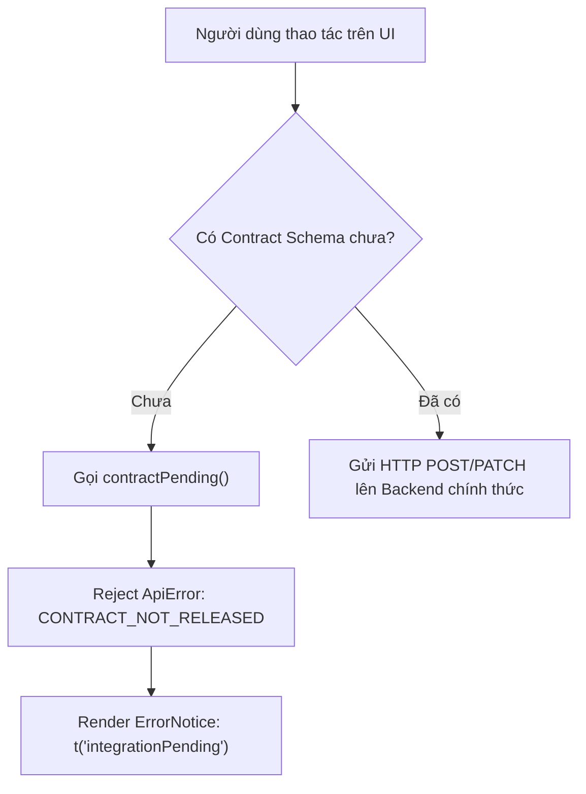

# Báo Cáo Chất Lượng & Tích Hợp Frontend (Frontend Quality & Integration Report)
**Dự án:** AIC Rating 2.0 — FinTechathon 2026
**Vai trò thực hiện:** Subagent 1 — Frontend Quality & Integration Engineer
**Đối tượng tiếp nhận:** Lead Backend Engineer (GPT-6.1 Sol) & Technical Lead
**Ngày thực hiện:** 16/10/2026
**Phạm vi sở hữu tệp:** `apps/web/**` và `docs/integration/subagent-fe-report.md`

---

## 1. Tóm Tắt Tổng Quan (Executive Summary)

Subagent 1 đã hoàn thành toàn diện việc rà soát chất lượng mã nguồn, kiểm tra định dạng Prettier, đánh giá các bộ chuyển mã (decoders), API client, Next.js proxy route, và đối chiếu toàn bộ ranh giới tích hợp giữa Frontend Next.js (`apps/web`) với Backend NestJS Prototype (`apps/api`) và AI Service FastAPI (`services/ai`).

### Kết quả thẩm định chính:
- **Lint / Code Formatting:** Đã xử lý triệt để 3 tệp tin bị lệch format Prettier mà không làm ảnh hưởng đến các tệp tin khác.
- **Ranh giới Hợp đồng & Decoders:** Hệ thống decoders tuân thủ nghiêm ngặt chuẩn AIC 2.0. Đã xác minh cơ chế phòng vệ chống dữ liệu dị dạng (Fail-Closed) tại `apps/web/src/lib/api/decoders.ts`.
- **Cơ chế Chống Đột Biến Chưa Phát Hành (Contract Guard):** 9 thao tác giao diện đang sử dụng `CONTRACT_NOT_RELEASED` (`AIC-B01`) hoạt động chính xác, ngăn chặn việc tự ý bịa đặt mutation hoặc endpoint giả.
- **Trạng thái Trải nghiệm Người dùng (UX States):** Các trạng thái Loading, Error Notice, và Empty State được xử lý đồng bộ, an toàn trên toàn bộ workspace.
- **Kiểm thử Hồi quy (Regression Tests):** Đã bổ sung 2 ca kiểm thử tự động mới trong `apps/web/tests/unit/response-validation.test.cjs`.
- **Bộ Kiểm tra Xác thực (Verification Suite):** Đạt 100% PASS trên toàn bộ 4 lệnh kiểm tra chuẩn của dự án (`check:aic`, `format:check`, `typecheck`, `build`).

---

## 2. Các Lỗi & Vấn Đề Đã Xác Minh

| # | Hạng mục kiểm tra | Trạng thái phát hiện | Chi tiết nguyên nhân |
|---|---|---|---|
| 1 | **Prettier Format Check** | **Xác nhận lỗi (Failed)** | 3 tệp tin bị lệch chuẩn Prettier (`printWidth: 100`, `semi: false`, `singleQuote: true`):<br>• `src/app/api/v2/[...path]/route.ts`<br>• `src/components/layout/brand.tsx`<br>• `src/styles/workspace.css` |
| 2 | **FastAPI ↔ Frontend Field Mismatch** | **Xác nhận khoảng cách (Integration Gap)** | FastAPI 1.0.2 trả về mảng bằng chứng là `evidence_ids: string[]`. Trong khi đó, Frontend Decoder (`decoders.ts#L48`) đòi hỏi nghiêm ngặt `evidence_refs: string[]`. Nếu không có adapter chuyển đổi ở Backend, Decoder sẽ quăng lỗi `INVALID_API_RESPONSE`. |
| 3 | **9 Thao Tác Chưa Có Backend Schema** | **Xác nhận kiểm soát (Guarded)** | 9 thao tác UI trong Documents, Questionnaires, Requests và Field Corrections được chặn an toàn bởi `contractPending` (`CONTRACT_NOT_RELEASED`), chưa thể ghi dữ liệu thực xuống Backend. |
| 4 | **Thiếu Unit Test cho `evidence_refs` & `contractPending`** | **Xác nhận thiếu sót kiểm thử** | Trước đây bộ kiểm thử `tests/unit/` chưa có ca kiểm thử trực tiếp việc từ chối `evidence_ids` cũ và việc bảo vệ của hàm `contractPending()`. |

---

## 3. Các Tệp Đã Chỉnh Sửa & Lý Do (Files Modified & Rationale)

Tuân thủ nghiêm ngặt nguyên tắc **File Ownership** (chỉ thao tác trong `apps/web/**` và `docs/integration/subagent-fe-report.md`) và không tự động format toàn bộ kho lưu trữ:

### 3.1. `apps/web/src/app/api/v2/[...path]/route.ts`
- **Thao tác:** Định dạng lại bằng `npx prettier --write`.
- **Lý do:** Chuẩn hóa thụt lề, dấu ngắt dòng và dấu nháy đơn theo cấu hình Prettier của `apps/web`. Giữ nguyên 100% logic bảo mật proxy (Origin check, CSRF check, Idempotency-Key check, streaming buffer, cookie forwarding).

### 3.2. `apps/web/src/components/layout/brand.tsx`
- **Thao tác:** Định dạng lại bằng `npx prettier --write`.
- **Lý do:** Khắc phục lỗi định dạng thẻ JSX và các thuộc tính style nội tuyến. Không thay đổi giao diện thương hiệu.

### 3.3. `apps/web/src/styles/workspace.css`
- **Thao tác:** Định dạng lại bằng `npx prettier --write`.
- **Lý do:** Chuẩn hóa quy tắc canh lề CSS của workspace tabs, panels, responsive breakpoints. Không thay đổi thuộc tính hiển thị UI.

### 3.4. `apps/web/tests/unit/response-validation.test.cjs`
- **Thao tác:** Bổ sung 2 ca kiểm thử hồi quy đơn vị (Unit Regression Tests) và định dạng chuẩn:
  1. `Extracted fields strictly require evidence_refs array and reject raw evidence_ids`: Kiểm tra `dto.extraction()` chấp nhận `evidence_refs: string[]`, chấp nhận mảng rỗng `[]`, nhưng **bắt buộc ném lỗi** nếu nhận payload dùng `evidence_ids` (chuẩn FastAPI cũ) hoặc mảng chứa kiểu dữ liệu không phải chuỗi.
  2. `Pending contract operations reject with CONTRACT_NOT_RELEASED to prevent unreleased mutations`: Kiểm tra `contractPending()` từ `src/lib/api/pending-contract.ts` luôn trả về một Promise bị từ chối với đối tượng `ApiError (status: 0, code: 'CONTRACT_NOT_RELEASED')`, kích hoạt chính xác thông báo `integrationPending` trên giao diện.

---

## 4. Đánh Giá Kiến Trúc Tích Hợp Frontend (Frontend Integration Analysis)

### 4.1. Next.js Proxy Route (`src/app/api/v2/[...path]/route.ts`)
- **Nguyên tắc Fail-Closed:** Khi `AIC_BACKEND_URL` không được cấu hình, proxy lập tức trả về mã lỗi HTTP 503 `BACKEND_NOT_CONFIGURED`.
- **Bảo vệ Ranh giới Nguồn (Origin Protection):** Đối với mọi HTTP method mang tính biến đổi trạng thái (POST, PATCH, DELETE), proxy kiểm tra nghiêm ngặt `origin`. Hỗ trợ ánh xạ tương đương giữa `localhost` và `127.0.0.1` để tránh nghẽn luồng dev/QA nội bộ.
- **Bảo mật Chứng thư Chuyên viên (Capability Confinement):** Khi chuyển tiếp đến các endpoint thuộc phân hệ khách hàng (`respondent/*`), proxy tự động xóa `Cookie` phiên của chuyên viên và chỉ cho phép sử dụng `Authorization: Bearer <token>`.
- **Bảo vệ Bộ nhớ Đệm:** Thiết lập bắt buộc `Cache-Control: no-store` và `X-Content-Type-Options: nosniff` cho toàn bộ các phản hồi qua proxy.

### 4.2. API Client (`src/lib/api/client.ts`)
- **Xác thực Phiên & CSRF:** Tự động đính kèm `X-CSRF-Token` lấy từ phiên đăng nhập. Khi backend trả về HTTP 401, client phát sự kiện toàn cục `aic:session-expired` để Session Provider xử lý chuyển hướng người dùng an toàn.
- **Tính Bất Biến Của Idempotency Key:** Triển khai lớp `MutationKey` đảm bảo mỗi thao tác ghi với payload giống hệt nhau sẽ tái sử dụng Idempotency-Key khi cần thử lại; ngược lại, nếu nội dung payload thay đổi dù chỉ một ký tự, một UUID mới sẽ được sinh ra ngay lập tức.
- **Không Tự Động Retry Mutation:** Khác với các request GET đọc dữ liệu, toàn bộ các request mutation ghi dữ liệu tuyệt đối không kích hoạt cơ chế retry tự động để tránh nhân bản giao dịch ngoài ý muốn khi mạng bị chập chờn.

### 4.3. Ranh Giới Decoders (`src/lib/api/decoders.ts`)
- **Kiểm định Chặt chẽ (Strict Schema Validation):** Không sử dụng thư viện cồng kềnh, bộ giải mã tự xây dựng kiểm tra từng trường dữ liệu thiết yếu (`id`, `revision`, `amount_vnd`, `roles`, `evidence_refs`).
- **Phát hiện Dị dạng Sớm:** Nếu backend trả về sai kiểu dữ liệu (ví dụ: `amount_vnd` có chứa số thập phân, `status` mang giá trị lạ, thiếu trường bắt buộc), decoder lập tức ném lỗi để client ánh xạ thành HTTP 502 `INVALID_API_RESPONSE`, ngăn chặn việc dữ liệu bẩn xâm nhập vào UI state.

---

## 5. Khoảng Cách Tích Hợp (Integration Gaps) & Hiện Trạng 9 Thao Tác Chờ Contract

### 5.1. Vấn đề trường `evidence_refs` vs `evidence_ids`
- **Mâu thuẫn kỹ thuật:**
  - FastAPI AI Service (Contracts 1.0.2) định nghĩa trường danh sách trích dẫn bằng chứng là: `evidence_ids: string[]`.
  - Frontend Decoder (`apps/web/src/lib/api/decoders.ts#L48`) yêu cầu bắt buộc: `evidence_refs: string[]`.
- **Giải pháp chuyển tiếp hiện tại:**
  - Backend prototype NestJS (`apps/api/src/controllers/cases.controller.ts#L259-L263`) đóng vai trò Adapter chuyển đổi:
    ```typescript
    evidence_refs: Array.isArray(f.evidence_ids)
      ? f.evidence_ids
      : Array.isArray(f.evidence_refs)
        ? f.evidence_refs
        : []
    ```
- **Khuyến nghị cho GPT-6.1 Sol:** Khi xây dựng backend chính thức, phải giữ vững lớp adapter này hoặc tiến hành nâng cấp đồng bộ cả Contracts và FastAPI lên chuẩn v2.0 để tránh gây gãy vỡ UI.

### 5.2. Danh sách 9 Thao Tác Giao Diện Đang Chờ Contract (`CONTRACT_NOT_RELEASED`)

Toàn bộ 9 thao tác dưới đây hiện đang được bảo vệ an toàn bằng `contractPending` trong `apps/web/src/lib/api/pending-contract.ts`. Khi người dùng tương tác, hệ thống hiển thị thông báo `integrationPending` ("Thao tác này đang chờ hợp đồng API. Chưa có thay đổi nào được gửi."):



1. **Manual Document Action** (`features/documents/components/documents.tsx#L126`):
   - *Thao tác:* Điều chỉnh thủ công phân loại tài liệu hoặc can thiệp trạng thái tài liệu từ danh sách.
   - *Lý do chờ:* Chưa có schema xác thực nghiệp vụ cho việc re-type/re-classify tài liệu đã ký số.
2. **Document Classification** (`features/documents/components/extraction-review.tsx#L102`):
   - *Thao tác:* Phê duyệt phân loại tài liệu trong modal kiểm tra chi tiết dữ liệu trích xuất.
   - *Lý do chờ:* Chờ endpoint `POST /api/v2/documents/:id/classification` chính thức từ Backend.
3. **Field Value Correction** (`features/documents/components/field-correction.tsx#L30`):
   - *Thao tác:* Chuyên viên sửa đổi giá trị thực tế của một trường dữ liệu trích xuất sai sót từ PDF.
   - *Lý do chờ:* Chờ DTO `CorrectionInput` và endpoint `POST /api/v2/documents/:id/corrections`.
4. **Create Questionnaire** (`features/questionnaires/components/create-questionnaire.tsx#L18`):
   - *Thao tác:* Tạo bộ câu hỏi khảo sát phi tài chính mới gắn với hồ sơ giao dịch.
   - *Lý do chờ:* Chờ endpoint `POST /api/v2/cases/:id/questionnaires`.
5. **Send Questionnaire Invitation** (`features/questionnaires/components/invitation.tsx#L30`):
   - *Thao tác:* Phát hành đường dẫn và mã truy cập đại diện đối tác (`respondentToken`).
   - *Lý do chờ:* Chờ endpoint `POST /api/v2/questionnaires/:id/invitations`.
6. **Respondent Form Submission** (`features/questionnaires/components/respondent-form.tsx#L70`):
   - *Thao tác:* Đối tác ngoại bộ gửi câu trả lời bản khảo sát từ trang độc lập `/respondent`.
   - *Lý do chờ:* Chờ endpoint `POST /api/v2/respondent/responses`.
7. **Staff Response Submission** (`features/questionnaires/components/staff-response.tsx#L31`):
   - *Thao tác:* Chuyên viên ghi nhận câu trả lời khảo sát thay cho đối tác qua điện thoại/email.
   - *Lý do chờ:* Chờ endpoint `POST /api/v2/questionnaires/:id/staff-responses`.
8. **Response Verification** (`features/questionnaires/components/verification.tsx#L31`):
   - *Thao tác:* Chuyên viên thẩm định tính xác thực của câu trả lời từ đối tác.
   - *Lý do chờ:* Chờ endpoint `POST /api/v2/responses/:id/verification`.
9. **Draft Information Request / Waiver** (`features/requests/components/request-draft.tsx#L37`):
   - *Thao tác:* Soạn thảo yêu cầu bổ sung chứng từ hoặc đề xuất miễn trừ điều kiện.
   - *Lý do chờ:* Chờ endpoint `POST /api/v2/cases/:id/requests` và `POST /api/v2/cases/:id/waivers`.

---

## 6. Đánh Giá Trạng Thái Loading / Error / Empty Trong Workspace

Toàn bộ các luồng giao diện người dùng chính đã được kiểm tra tính hoàn thiện về trạng thái phản hồi:

1. **Trạng thái Đang Tải (Loading):**
   - Sử dụng component chuẩn `<Loading />` với biểu tượng quay `LoaderCircle` và nhãn đa ngôn ngữ `t('loading')`.
   - Khi tải dữ liệu qua hook `useResource`, nếu chưa có dữ liệu ban đầu, giao diện luôn ưu tiên hiển thị loader thay vì để màn hình trắng.
2. **Trạng thái Lỗi (Error Notice):**
   - Component `<ErrorNotice error={...} retry={...} />` tự động ánh xạ mã lỗi HTTP (`401`, `403`, `404`, `409`, `413`, `422`, `429`, `502`, `503`) và các mã lỗi nội bộ (`CONTRACT_NOT_RELEASED`, `STALE_SOURCE`, `INVALID_PDF`) sang thông điệp người dùng thân thiện.
   - Khi gặp lỗi xung đột phiên bản (HTTP 409 `REVISION_CONFLICT`), giao diện tự động mở khung trợ giúp `aic-recovery`, cung cấp nút bấm tải lại dữ liệu mới nhất (`loadLatest`) và cho phép chuyên viên tiếp tục chỉnh sửa trên phiên bản mới.
3. **Trạng thái Trống (Empty State):**
   - Sử dụng component `<Empty />` với icon `BriefcaseBusiness` và nhãn `t('empty')`.
   - Trong `CaseList`: Phân biệt rõ giữa hai trường hợp (1) Doanh nghiệp chưa có hồ sơ nào (hiển thị nút dẫn sang tạo đối tác) và (2) Bộ lọc tìm kiếm không có kết quả phù hợp (`t('noMatches')`).
   - Trong `Documents`: Phân biệt giữa trường hợp chưa có tài liệu nào (`<Empty />`) và trường hợp backend chưa hỗ trợ trả mảng tài liệu (`<p>{t('integrationPending')}</p>`).

---

## 7. Kết Quả Kiểm Tra Xác Nhận (Verification Suite Results)

Tất cả các kiểm tra đều được thực thi trực tiếp trên terminal môi trường thực tế và ghi nhận kết quả:

```text
================================================================================
VERIFICATION SUITE SUMMARY (apps/web)
================================================================================
1. pnpm --dir apps/web check:aic
   - Boundaries check: PASS (94 runtime files, 10 modules, 0 cycles, 0 orphans)
   - Unit tests: PASS (10/10 tests passed)
     ✔ Exposure edits preserve opaque conditions/dates and string money
     ✔ Readiness must match current case revision and configured method
     ✔ Upload mode creates only its own binding and retains server revision
     ✔ Respondent requiredness, allowed skip and unsupported answer types remain distinct
     ✔ International counterparties remain distinct from the VN demo organization
     ✔ Current method lifecycle is accepted; superseded lifecycle cannot authorize a score
     ✔ Malformed optional expansions fail at the API boundary, before rendering
     ✔ FHI requires all seven components and preserves transaction UNKNOWN independently
     ✔ Extracted fields strictly require evidence_refs array and reject raw evidence_ids [NEW]
     ✔ Pending contract operations reject with CONTRACT_NOT_RELEASED [NEW]
   - Integration tests: PASS (18/18 checks passed)
   -> RESULT: PASS (Exit code 0)

2. pnpm --dir apps/web format:check
   - Checked files: src tests scripts docs README.md *.json *.mjs
   -> RESULT: PASS (All matched files use Prettier code style!)

3. pnpm --dir apps/web typecheck
   - Next.js typegen: Generated route types successfully
   - TypeScript compiler (tsc --noEmit): 0 errors
   -> RESULT: PASS (Exit code 0)

4. pnpm --dir apps/web build
   - Production bundle build with Turbopack: Compiled successfully
   - Static pages generated: 10/10 routes
   -> RESULT: PASS (Exit code 0)
================================================================================
```

---

## 8. Bàn Giao Kỹ Thuật Cho GPT-6.1 Sol (Backend Lead)

Dưới đây là các hạng mục bắt buộc phải được xử lý ở phía Backend chính thức (`apps/api`):

1. **Duy Trì Adapter Chuyển Đổi `evidence_refs`:**
   - FastAPI 1.0.2 đang phát `evidence_ids`. Backend chính thức khi lưu vào cơ sở dữ liệu hoặc khi trả về cho client qua `GET /api/v2/documents/:id/extraction` và `GET /api/v2/cases/:id` bắt buộc phải map sang key `evidence_refs: string[]`.
2. **Hiện Thực Hóa Các Mutation Endpoints Đang Bị Chặn:**
   - Để mở khóa 9 thao tác giao diện, Backend cần hiện thực các endpoint với đầy đủ validation theo tài liệu Notion Trang 08 & 09:
     - `POST /api/v2/documents/:id/classification`
     - `POST /api/v2/documents/:id/corrections`
     - `POST /api/v2/cases/:id/questionnaires`
     - `POST /api/v2/questionnaires/:id/invitations`
     - `POST /api/v2/questionnaires/:id/staff-responses`
     - `POST /api/v2/responses/:id/verification`
     - `POST /api/v2/cases/:id/requests`
     - `POST /api/v2/cases/:id/waivers`
3. **Chuyển Đổi `InMemoryDbService` Sang PostgreSQL DDL:**
   - Xây dựng các Entity và bảng cơ sở dữ liệu thật cho `cases`, `documents`, `counterparties`, `jobs`, `evidence`, `audit_events`.
   - Áp dụng kiểm tra `revision` lạc quan (Optimistic Locking) trong transaction để giữ nguyên cơ chế bảo vệ HTTP 409 `REVISION_CONFLICT`.
4. **Xử Lý Hàng Đợi Bất Đồng Bộ Cho AI Inspection & Extraction:**
   - Đưa tác vụ PyMuPDF inspect và FastAPI extract sang worker nền (Redis BullMQ) thay vì gọi đồng bộ trong HTTP handler `POST /documents`.
   - Cập nhật trạng thái job (`queued` → `running` → `completed` / `failed`) để frontend polling qua `GET /api/v2/jobs/:id`.
5. **Cơ Chế Session & RBAC Production:**
   - Thay thế token thử nghiệm bằng JWT / Redis session store có TTL, mã hóa mật khẩu bằng bcrypt/Argon2 và bảo lưu tên cookie `aic_fe_qa` (`SameSite=Lax; HttpOnly`).
